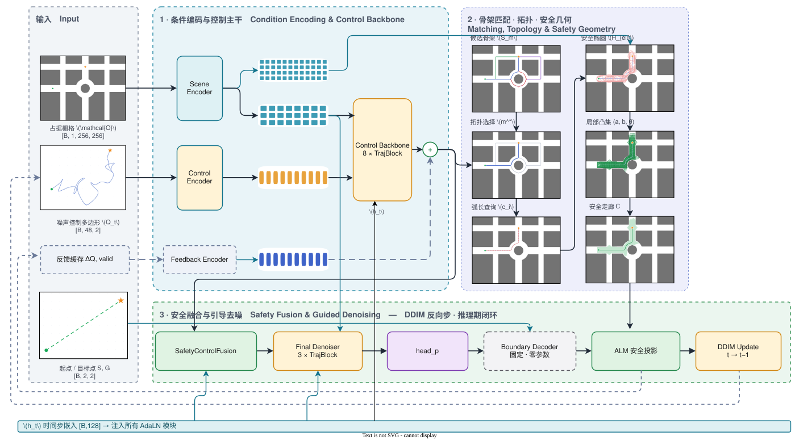
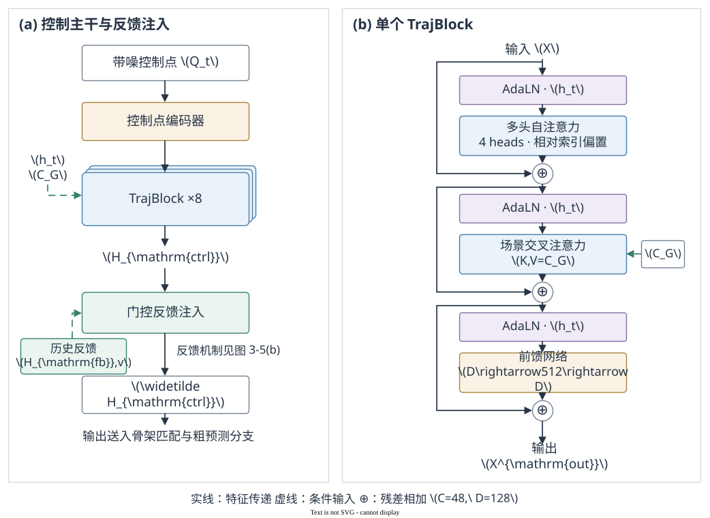
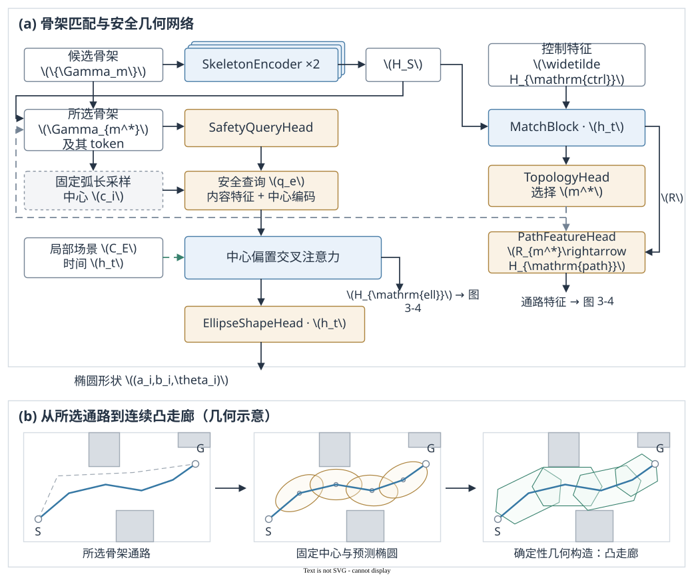
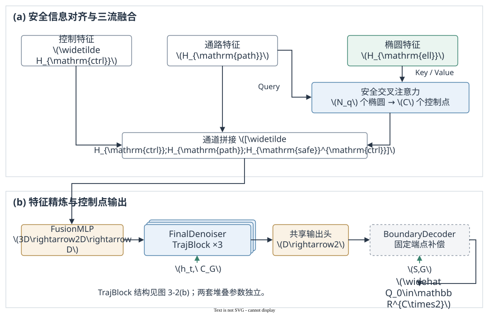
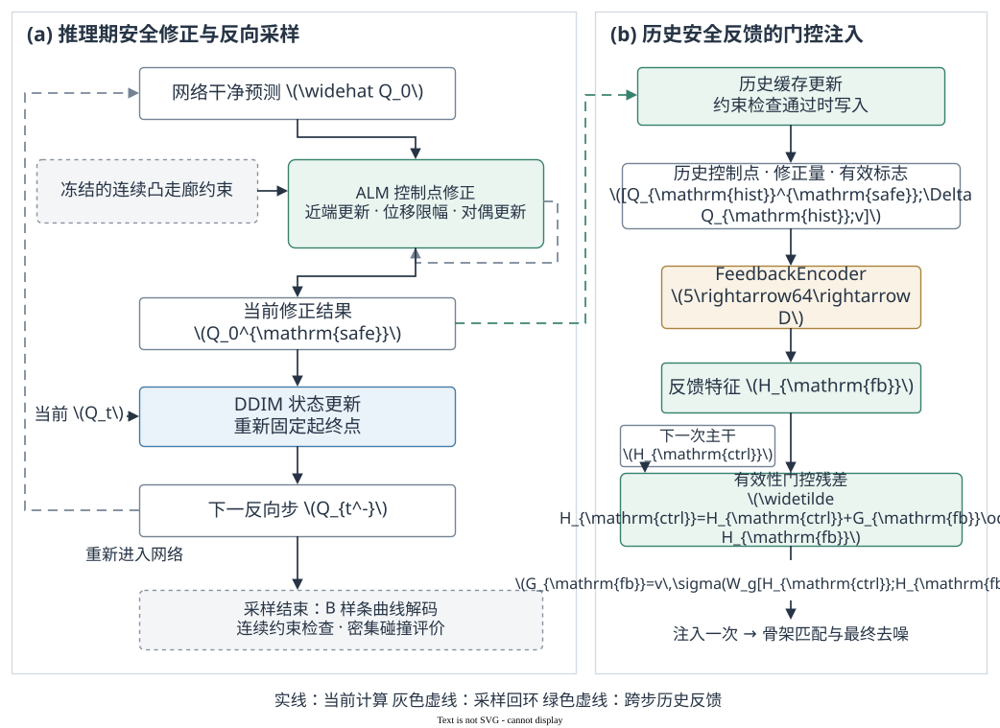
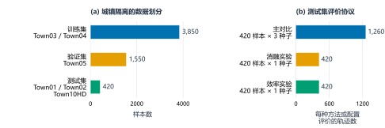

# TrajSafe-Diffuser：生成式安全约束下的扩散运动规划方法

## 摘要

扩散模型为运动规划提供了一种数据驱动的多模态轨迹生成方式，然而，其生成过程无法显式保证轨迹安全性。现有改进方法通常依赖外部提供的安全约束，而固定的约束表示难以充分适应复杂非凸环境中的空间结构变化，进而限制了扩散规划方法在复杂场景中的应用。
针对上述问题，本文提出一种生成式安全约束下的扩散运动规划方法。该方法首先利用环境结构信息自动构建与场景匹配的安全约束表示，并将其融入扩散去噪过程引导轨迹生成；随后，在逆扩散过程中引入约束优化机制对生成结果进行安全修正，并通过安全反馈链路将历史修正信息注入后续去噪步骤，从而提升复杂环境下的规划可靠性。
在处理后的 CARLA 道路场景上进行了实验验证。测试集包含 420 个样本，主实验采用 3 个随机种子重复生成，共得到 1260 条轨迹。本文方法在全部生成结果中均未发生碰撞，安全可行率达到 100%。消融实验进一步表明，走廊约束负责消除残余违规，历史反馈能够减少后续去噪步骤的重复纠偏；在当前测试协议下，4 步采样仍保持 0 次碰撞，并显著降低了推理时间。

**关键词：**扩散运动规划；生成式安全约束；凸安全走廊；闭环安全反馈；增广拉格朗日法

## 1 引言
运动规划是移动机器人、自主智能体以及具身系统实现自主决策的重要组成部分，其目标是在给定环境信息、初始状态和任务目标的条件下生成满足安全性、连续性和可执行性的运动轨迹。传统运动规划方法通常依赖显式环境模型，通过搜索、采样或优化求解获得可行路径。然而，在复杂非凸环境中，规划空间往往包含大量局部障碍结构和多种可行拓扑，仅依赖确定性规划过程难以同时兼顾轨迹多样性、安全性以及规划效率。
近年来，扩散模型凭借其强大的分布建模能力，为运动规划提供了一种新的数据驱动生成范式。通过学习轨迹数据分布，扩散模型能够在给定环境和任务条件下生成具有多模态特征的运动方案，使规划过程由传统的单一优化求解转变为基于生成模型的轨迹采样过程。然而，扩散模型本质上学习的是数据分布规律，其生成过程并不显式考虑环境安全约束，即使训练数据满足可行性要求，生成结果仍可能由于分布偏移、采样误差或复杂环境变化产生碰撞风险。
为提升扩散规划的安全性，现有研究通常通过在生成过程中引入额外安全约束或优化机制，对生成结果进行引导和修正。然而，这类方法通常依赖外部提供的安全约束表示，即假设环境中的安全区域、可行集合或约束函数已经已知。对于具有复杂非凸障碍、多拓扑通路和局部狭窄区域的环境，预先定义的安全表示往往难以充分描述实际可行空间，使得约束引导效果受到限制。因此，如何利用环境结构信息构建与任务相关的安全约束表示，减少对预定义安全约束的依赖，仍然是安全扩散规划中的一个重要挑战。
进一步而言，安全约束不仅需要满足轨迹生成过程中的可行性要求，还需要具备与环境结构相匹配的表达能力，并能够有效融入扩散采样过程。因此，理想的安全表示应能够反映自由空间结构，将复杂环境中的隐式可行区域转换为连续轨迹可验证的几何约束，并与生成模型形成有效交互。
针对上述问题，本文提出 TrajSafe-Diffuser，一种生成式安全约束下的扩散运动规划方法。该方法首先利用环境结构信息生成与当前任务匹配的安全约束表示，将复杂非凸自由空间转换为适用于连续轨迹规划的局部安全区域。随后，将生成的安全约束作为条件信息融入扩散去噪过程，使轨迹生成过程能够同时考虑运动分布和安全可行性。在推理阶段，引入约束优化机制对当前生成结果进行安全修正，并将历史修正信息反馈至后续去噪步骤，实现安全约束与扩散生成过程的闭环融合。
本文的主要贡献如下：
（1）提出一种面向扩散运动规划的生成式安全约束构建方法。该方法根据环境结构信息自动生成任务相关的安全约束表示，使复杂环境中的安全可行空间能够被显式建模并用于后续轨迹生成。
（2）提出安全约束与扩散规划融合的方法。通过将生成的安全几何表示融入轨迹去噪过程，引导扩散模型生成满足安全约束的运动轨迹，而非仅依赖后处理修正。
（3）提出闭环安全修正机制。通过在逆扩散过程中引入约束优化，并将修正结果反馈至后续生成步骤，使安全约束能够持续影响轨迹生成过程，提高复杂环境下规划的可靠性。

## 2 相关工作
扩散运动规划将轨迹作为整体生成对象，通过迭代去噪与任务条件建模多模态运动分布。环境编码、目标条件和代价引导进一步增强了生成结果对场景与任务的适应性。然而，分布学习与约束满足是不同问题：训练示范可行并不意味着每次随机采样都可行，因此仍需显式处理生成过程中的安全约束。

安全扩散规划通过控制屏障函数、惩罚引导、投影或原始—对偶优化，将安全要求融入逆扩散过程。这类方法重点解决给定安全函数或可行集合下的受约束生成。本文关注与之互补的问题：如何从复杂非凸环境中构建任务相关的几何约束，并使约束修正的信息参与后续去噪，而非仅对各步预测独立纠偏。

凸几何规划通过障碍分离与局部区域构造，将自由空间表示为可供连续轨迹优化使用的凸集合；区域图进一步描述局部集合之间的连通关系。本文沿用凸区域便于验证连续曲线的几何性质，但不以独立的全局区域分解替代生成模型，而是由任务相关骨架与学习到的局部尺度组织连续走廊，并将几何特征、约束优化和历史反馈统一到扩散采样中。

## 3 方法

### 3.1 方法概述

给定经过障碍扩张的占据栅格 \(O\in\{0,1\}^{H\times W}\)、起点 \(S\in\mathbb R^2\) 和终点 \(G\in\mathbb R^2\)，TrajSafe-Diffuser 在自由空间 \(\mathcal F\) 内生成连接起终点的连续轨迹。本文采用夹持节点向量的三次 B 样条，将生成变量表示为控制多边形 \(Q_t=[q_{t,0},\ldots,q_{t,C-1}]\in\mathbb R^{C\times2}\)，对应曲线为 \(\tau_t(u)=\sum_{j=0}^{C-1}B_{j,3}(u)q_{t,j}\)，其中 \(u\in[0,1]\)。控制点数设为 \(C=48\)；每次网络输入和采样更新后均固定 \(q_{t,0}=S\)、\(q_{t,C-1}=G\)。由夹持 B 样条的端点性质，这一操作使连续曲线准确连接任务边界，而不要求网络学习端点位置。

图 3-1 TrajSafe-Diffuser 总体框架。场景编码器提供全局场景与局部几何特征；控制主干编码带噪控制点，并接收历史安全反馈。骨架匹配分支选择任务相关通路，生成椭圆几何特征；确定性几何模块构建连续凸走廊。融合网络预测干净控制点，ALM 修正、DDIM 状态更新与历史反馈形成跨步闭环。三流融合与安全修正分别展开于图 3-4 和图 3-5。

方法区分两种安全信息：可学习的椭圆几何特征参与网络去噪，确定性的凸走廊约束参与控制点优化。前者提供环境相关的生成条件，后者检查并修正网络残留的违规，不能将二者等同为同一个“安全模块”。逆扩散的每个步骤先执行条件编码、骨架匹配和特征融合，再根据已激活的走廊处理当前干净预测。修正结果既用于更新扩散状态，也作为历史信息输入后续网络。标准推理配置在前三个反向步骤预热，之后尝试激活安全走廊；激活成功后冻结所选通路、走廊和连续约束包，以保持后续修正与反馈的一致性。

为避免控制点数、安全查询数与曲线采样数混淆，表 3-1 统一主要符号。以下公式省略批维，\(B\) 表示批大小，方括号表示张量形状；正文与小节插图统一用 \(N_q\) 表示安全查询数，以区别于控制多边形 \(Q_t\)。插图仅保留理解结构所需的关键符号，完整维度与计算细节在正文中说明。

表 3-1 网络结构的主要符号与默认尺寸

| 符号 | 含义 | 默认尺寸或取值 |
|---|---|---|
| \(C,D\) | 控制点数、特征维度 | \(48,128\) |
| \(M,L\) | 候选通路数、每条候选的编码点数 | \(4,128\) |
| \(N_q\) | 安全几何查询数 | \(128\) |
| \(C_G,C_E\) | 全局场景记忆、局部几何记忆 | \(256\times D,\ 1024\times D\) |
| \(H_{\mathrm{ctrl}},\widetilde H_{\mathrm{ctrl}}\) | 主干输出、融合历史反馈后的控制特征 | \(C\times D\) |
| \(H_S,H_{\mathrm{path}},H_\Gamma\) | 骨架编码、控制点通路特征、安全查询特征 | \(M\times L\times D,\ C\times D,\ N_q\times D\) |
| \(H_{\mathrm{ell}},H_{\mathrm{safe}}^{\mathrm{ctrl}}\) | 椭圆几何特征、映射至控制点的安全特征 | \(N_q\times D,\ C\times D\) |

为明确总图中控制主干和历史反馈的关系，图 3-2 先给出该结构的展开；其计算方式在第 3.3 节说明，反馈缓存与验证规则在第 3.4 节说明。

图 3-2 控制点主干与 TrajBlock 结构。（a）控制点编码后经过 8 层 TrajBlock，历史安全反馈仅在主干输出处门控注入一次，融合结果用于骨架匹配和粗预测。（b）单个 TrajBlock 包含时间调制、四头自注意力、全局场景交叉注意力与前馈网络，每个子层分别保留残差。堆叠框表示多层串联，不表示参数共享；实线表示特征传递，虚线表示条件输入，\(\oplus\) 表示残差相加。反馈编码与门控细节见图 3-5（b）。

### 3.2 生成式安全约束构建

#### 3.2.1 骨架编码与任务相关匹配

复杂自由空间中，直接回归区域中心容易产生位于障碍内部的种子。本文先从占据地图提取自由空间骨架，将起终点接入可见骨架节点，并通过图搜索获得最多 \(M=4\) 条候选通路。候选不足时使用有效性掩码，缺少可用候选的样本不能获得走廊安全证书。每条通路保留两种表示：含 \(L=128\) 个坐标的序列用于网络编码，完整的安全折线用于后续中心插值。两种表示承担不同功能，不能使用稀疏编码点之间的跨障碍弦线替代完整通路。

图 3-3 骨架匹配网络与安全几何构造。（a）候选骨架经两层 SkeletonEncoder 编码，与控制特征匹配后由 TopologyHead 选择通路。所选匹配特征 \(R_{m^*}\) 生成控制点通路特征；所选骨架 token 与固定弧长中心组成安全查询，中心偏置交叉注意力读取局部场景，预测椭圆形状并输出椭圆特征。（b）几何示意依次展示所选骨架、固定中心处的预测椭圆，以及确定性几何算子生成的重叠凸区域。灰色块表示障碍物，蓝色线表示所选通路；该子图是概念示意而非实验结果。中心不由网络回归，预测椭圆本身不构成无碰撞保证；最终走廊还需通过有效性、连通性等检查。

SkeletonEncoder 对候选坐标施加二维位置编码、独立坐标 MLP 和一维索引编码，再经过两层自注意力—前馈网络得到 \(H_{S,m}\)。该编码器只接收候选坐标，不接收扩散时间或场景记忆。任务相关性由 MatchBlock 建立：以经过时间调制的 \(\widetilde H_{\mathrm{ctrl}}\) 为查询，以 \(H_{S,m}\) 为键和值，在所有候选间共享匹配参数。其输出包含注意力残差和前馈残差：

\(U_m=\widetilde H_{\mathrm{ctrl}}+\operatorname{CA}(\operatorname{AdaLN}(\widetilde H_{\mathrm{ctrl}},h_t),H_{S,m})\)。

\(R_m=U_m+\operatorname{FFN}_{\mathrm{match}}(\operatorname{LN}(U_m))\)。

这里 \(\operatorname{CA}\) 包含查询、键、值的线性投影和多头输出投影。TopologyHead 在控制点轴上平均池化 \(R_m\)，通过评分 MLP 产生 \(\ell_m\)，并对有效候选集合 \(\mathcal V\) 执行掩码归一化：\(\pi_m=\exp(\ell_m)/\sum_{k\in\mathcal V}\exp(\ell_k)\)。未激活走廊时优先选择 \(m^*=\arg\max_{m\in\mathcal V}\pi_m\)。若优先候选不能构成有效走廊，激活模块尝试其余候选；成功激活后固定该索引，避免后续网络改选通路而优化仍使用旧走廊。

同一匹配结果还通过 PathFeatureHead 得到 \(H_{\mathrm{path}}=\operatorname{MLP}_{\mathrm{path}}(R_{m^*})\)。该特征保持 \(C\) 个控制 token，用于表示控制点与所选通路的对应关系，并不是学习得到的通路进度。

#### 3.2.2 固定中心与椭圆几何查询

安全查询分支在所选骨架的 \(N_q=128\) 个 token 上独立执行 SafetyQueryHead，得到 \(H_\Gamma\)。PathFeatureHead 与 SafetyQueryHead 均采用层归一化及 \(D\rightarrow256\rightarrow D\) 的 SiLU MLP，但二者参数独立，输出 token 数也不同。中心分支则由无可学习参数的 CurveDecoder 在完整通路的归一化弧长位置 \(s_i=i/(N_q-1)\) 进行插值，得到 \(c_i=\Gamma_{m^*}(s_i)\)。因此，中心依托已检查的自由空间折线，不随网络的形状回归漂移。

安全查询将骨架内容与中心位置编码相加：\(q_e=H_\Gamma+\operatorname{MLP}_c(\Phi_{xy}(c))\)。为读取中心附近的障碍结构，网络在对局部几何记忆 \(C_E\) 的交叉注意力中加入空间偏置。设 \(z_j\) 为第 \(j\) 个地图记忆 token 的栅格中心，偏置为

\(B_{ij}^{\mathrm{geo}}=\operatorname{clip}(-\bar\alpha_t\|z_j-c_i\|_2^2/(2\sigma_{\mathrm{geo}}^2),-b_{\mathrm{clip}},0)\)。

其中 \(\sigma_{\mathrm{geo}}=0.25\)、\(b_{\mathrm{clip}}=8\)，坐标采用归一化场景单位，\(\bar\alpha_t\) 是扩散累计信号系数。高噪声时空间偏置较弱，去噪后期逐渐增强对中心邻域的关注。椭圆几何特征为

\(H_{\mathrm{ell}}=q_e+\operatorname{CA}_{B_{\mathrm{geo}}}(\operatorname{AdaLN}(q_e,h_t),C_E)\)。

EllipseShapeHead 对 \(H_{\mathrm{ell}}\) 执行时间调制和 \(D\rightarrow256\rightarrow256\rightarrow4\) 的逐查询 MLP，输出稳定参数表示 \(e_i=(\log a_i,\log b_i,\cos2\theta_i,\sin2\theta_i)\)。这里 \(a_i,b_i\) 为椭圆半轴，\(\theta_i\) 为方向；双角表示消除椭圆方向相差 \(\pi\) 时的冗余。网络只预测局部尺度和方向，不预测中心或可学习进度。

#### 3.2.3 从椭圆尺度到连续凸走廊

预测椭圆为局部障碍分离提供各向异性度量，而非直接作为硬安全约束。几何构造器根据中心、形状和邻近障碍生成分离半空间，并加入局部窗口及地图边界约束，形成 \(\mathcal P_i=\{x\mid A_i x\leq b_i\}\)。几何模块不接收 \(h_t\)，也不含可学习参数；时间条件仅通过上游形状预测间接影响区域构造。

候选区域需通过数值有效性、有界性、多边形面积与连通性检查。骨架中心提供局部构造的锚点；走廊可行性以最终半空间区域的检查结果为准，而非由中心或预测椭圆的位置直接判定。

相邻区域采用归一化重叠率 \(\kappa_i=\operatorname{Area}(\mathcal P_i\cap\mathcal P_{i+1})/\min\{\operatorname{Area}(\mathcal P_i),\operatorname{Area}(\mathcal P_{i+1})\}\) 检查衔接。重叠不足时，沿完整通路的弧长中点补充桥接种子，避免急转弯处的欧氏中点落入障碍。通过整体检查的区域序列形成有序走廊 \(\mathcal C\)。标准配置构造 128 个基础区域；区域共享配置减少构造数量，但仍保留衔接检查。激活失败的样本记录失败状态，不视为已验证结果。

### 3.3 安全条件扩散轨迹生成

#### 3.3.1 控制点扩散与场景条件

本文在 B 样条控制点空间建立扩散过程。对干净控制多边形 \(Q_0\)，内部控制点满足 \(Q_t=\sqrt{\bar\alpha_t}Q_0+\sqrt{1-\bar\alpha_t}\,\epsilon\)，其中 \(\epsilon\sim\mathcal N(0,I)\)、\(\bar\alpha_t=\prod_{i=1}^t(1-\beta_i)\)。加噪后重新固定首末控制点，因此任务端点不服从该无条件高斯扰动。网络预测干净控制点而不是密集曲线上的逐点位移；曲线解码用于几何评价、损失或结果展示，不将密集采样点重新送入控制主干。

Scene Encoder 从占据栅格提取两种记忆：分辨率为 \(16\times16\) 的 \(C_G\) 参与全局场景交叉注意力，分辨率为 \(32\times32\) 的 \(C_E\) 服务于局部安全几何查询。控制点输入经编码得到 \(X_i^{(0)}=\operatorname{MLP}_T(\Phi_{xy}(q_{t,i}))+\operatorname{PE}_{1D}(i)\)。时间步独立编码为 \(h_t\)，注入各个 AdaLN 模块。起终点通过硬端点设置和输出端点补偿作用于控制多边形，而不是作为额外 token 输入场景编码器。

#### 3.3.2 控制主干与历史反馈注入

如图 3-2 所示，一个 TrajBlock 依次计算 \(X'=X+\operatorname{SA}(\operatorname{AdaLN}(X,h_t))\)、\(X''=X'+\operatorname{CA}(\operatorname{AdaLN}(X',h_t),C_G)\) 和 \(X'''=X''+\operatorname{FFN}(\operatorname{AdaLN}(X'',h_t))\)。自注意力使用 4 个头，每头维度为 32，并在注意力得分中加入由控制点索引距离决定的可学习偏置。FFN 的通道维度为 \(128\rightarrow512\rightarrow128\)，激活函数为 GELU。8 层主干输出 \(H_{\mathrm{ctrl}}\) 后，历史安全信息通过门控残差形成 \(\widetilde H_{\mathrm{ctrl}}\)，具体缓存和有效性规则见第 3.4 节。

融合后的特征同时影响粗预测、候选匹配、通路特征和后续去噪。粗控制点通过共享线性头及 BoundaryDecoder 产生；无候选时，该粗结果作为退化输出，但不能因此视为安全规划成功。正常样本则继续执行第 3.2 节的骨架匹配和安全几何生成。

#### 3.3.3 三流融合与最终干净控制点预测

图 3-4 安全信息对齐、三流融合与最终去噪。（a）安全交叉注意力模块以时间调制后的通路特征为查询、椭圆特征为键和值，并包含通路特征残差；它将 \(N_q=128\) 个椭圆的安全信息映射到 \(C=48\) 个控制点。控制、通路与对齐后的安全特征在通道轴拼接。（b）FusionMLP 将通道数从 \(3D\) 映射至 \(D\)，3 层 FinalDenoiser 精炼融合特征，随后经共享输出头和固定 BoundaryDecoder 生成干净控制多边形。TrajBlock 内部结构见图 3-2（b），最终去噪器与控制主干的参数独立；绿色虚线表示时间、场景或端点条件。

安全分支包含 \(N_q=128\) 个查询，而控制分支仅有 \(C=48\) 个 token，二者不能直接逐点拼接。SafetyControlFusion 以 \(H_{\mathrm{path}}\) 为查询，将 \(H_{\mathrm{ell}}\) 作为键和值，执行跨分支注意力并保留查询残差：

\(H_{\mathrm{safe}}^{\mathrm{ctrl}}=H_{\mathrm{path}}+\operatorname{CA}(\operatorname{AdaLN}(H_{\mathrm{path}},h_t),H_{\mathrm{ell}})\)。

所得特征维度为 \(C\times D\)，可与另外两流在通道轴拼接。FusionMLP 计算 \(F=\operatorname{MLP}_{\mathrm{fuse}}([\widetilde H_{\mathrm{ctrl}};H_{\mathrm{path}};H_{\mathrm{safe}}^{\mathrm{ctrl}}])\)，采用 \(\operatorname{LN}(3D)\rightarrow\operatorname{Linear}(3D,2D)\rightarrow\operatorname{GELU}\rightarrow\operatorname{Linear}(2D,D)\)。这里拼接的是对齐后的特征，而不是把控制点和椭圆 token 交错组成新序列。网络读取的是椭圆几何隐特征，硬半空间约束不直接作为该融合 MLP 的输入。

FinalDenoiser 由 3 层 TrajBlock 组成，与控制主干结构相同，但两套堆叠参数独立。其输出 \(H_{\mathrm{clean}}\) 通过共享线性头得到未补偿预测 \(\widetilde Q_0^{(t)}=\operatorname{Linear}(H_{\mathrm{clean}})\)。BoundaryDecoder 使用固定权重将端点误差分布到邻近控制点：

\(\widehat q_{0,i}^{(t)}=\widetilde q_{0,i}^{(t)}+w_i^S(S-\widetilde q_{0,0}^{(t)})+w_i^G(G-\widetilde q_{0,C-1}^{(t)})\)。

其中权重在相应端点为 1，并在各自边界窗口外为 0。该算子没有可学习参数，既准确设置端点，又避免仅替换首末控制点造成突变。本文将补偿后的 \(\widehat Q_0^{(t)}\) 称为当前原始干净预测  ；它尚未经过 ALM，不意味着已经满足走廊约束。

#### 3.3.4 联合训练与反馈展开

训练以参考控制多边形为监督，联合优化最终及粗控制点回归、控制点平滑和边界窗口损失，并加入候选拓扑分类、椭圆形状、软栅格重叠、障碍违规与走廊损失。拓扑标签由候选通路与参考轨迹的匹配产生；训练按标签选择分支，推理则按候选评分和走廊激活结果选择。固定中心无需额外中心回归损失，网络也不学习单调进度分布。

历史反馈训练使用两步展开：第一步生成当前预测并在停止梯度的分支中执行安全修正，构造下一步扩散状态和反馈；第二步网络接收反馈，继续接受控制点、边界、安全违规与曲线变化监督。梯度不穿过 ALM 求解器，第二步也不以复制 ALM 输出为回归目标。这样，反馈分支学习根据已验证的修正信息改善后续预测，而不是把数值优化直接替代去噪网络。

### 3.4 闭环安全修正与反馈

#### 3.4.1 连续曲线的走廊约束

仅约束离散曲线采样点不能排除点间碰撞。本文按照 B 样条节点区间与走廊责任区间进行精确细分，将每一段写为三次 Bézier 曲线。记第 \(\ell\) 段的四个 Bézier 控制点为 \(Z_\ell=E_\ell Q\)，其责任区域为 \(\mathcal P_{r(\ell)}\)。对四个控制点施加同一组半空间不等式：

\(A_{r(\ell)}(E_\ell Q)_k\leq b_{r(\ell)},\quad k=0,1,2,3\)。

三次 Bézier 曲线位于四个控制点的凸包内；当四个控制点均位于同一凸区域时，整段曲线也位于该区域。因此，对所有细分段满足上述约束可验证完整曲线的走廊归属，而非仅检查 128 或 512 个离散点。此结论以所构造走廊确实位于建模自由空间、约束可行及数值验证通过为前提，不涉及动态障碍、感知误差或车辆动力学保证。

图 3-5 推理期安全修正与跨步历史反馈。（a）ALM 在冻结的连续走廊约束上修正网络预测，修正结果用于 DDIM 状态更新；采样结束后解码曲线并进行碰撞评价。（b）通过接纳检查的控制点与修正量写入历史缓存，由 FeedbackEncoder 编码，在下一次主干输出处门控注入；未通过检查的结果不覆盖可信历史。实线表示当前计算，灰色虚线表示计算回环，绿色虚线表示跨步反馈。有限预算 ALM 的输出仍需检查约束满足情况。

#### 3.4.2 增广拉格朗日近端修正

对当前原始干净预测 \(Q^{\mathrm{ref}}=\widehat Q_0^{(t)}\)，设修正量为 \(\Delta=Q-Q^{\mathrm{ref}}\)。为在满足约束的同时保留生成先验，接近性与平滑性均作用于修正曲线：

\(J(\Delta)=\frac{\lambda_p}{2}\|B_{\mathrm{sp}}\Delta\|_F^2+\frac{\lambda_s}{2}\|D_2B_{\mathrm{sp}}\Delta\|_F^2\)。

其中 \(B_{\mathrm{sp}}\) 为 B 样条基矩阵，\(D_2\) 为曲线二阶差分算子；首末修正量固定为零。这样，原始预测已经可行且未积累约束力时，零修正是接近性目标的最优解，不会仅因绝对曲率正则而被重新拉动。

将全部有效半空间约束向量化为 \(g(Q)=\mathcal A(Q)-b\)，乘子为 \(\lambda\geq0\)。采用投影型不等式增广项 \(\big(\|[\lambda+\rho g(Q)]_+\|_2^2-\|\lambda\|_2^2\big)/(2\rho)\)，对应约束权重 \(\omega=[\lambda+\rho g(Q)]_+\) 和解析梯度 \(\nabla_Q=\mathcal A^*\omega\)，其中 \(\mathcal A^*\) 为约束线性算子的伴随。代码先将半空间力传回 Bézier 控制点，再经提取矩阵传回 B 样条控制点，不对密集曲线点进行逐点优化。

记内部控制点的目标 Hessian 为 \(H_I\)。每次内迭代对累计修正量求解 \((I+\eta H_I)\Delta_I^{\mathrm{prox}}=(\Delta_k-\eta\mathcal A^*\omega_k)_I\)，使用 Cholesky 分解处理该正定线性系统。随后对增量进行真实曲线位移限幅、沿控制点轴平滑并恢复固定端点，得到 \(Q_{k+1}\)；乘子按 \(\lambda_{k+1}=[\lambda_k+\rho g(Q_{k+1})]_+\) 更新。标准参数为 \(\rho=5\)、\(\eta=0.05\)，每个有效反向步骤最多执行 10 次内迭代，可行性容差为 \(10^{-3}\)。有限迭代只提供当前容差下的修正，不能把其输出直接等同于精确约束最优解。

#### 3.4.3 安全状态更新与可信历史缓存

安全修正通过两条不同路径影响后续生成。状态路径将当前修正结果 \(Q_{0,\mathrm{safe}}^{(t)}\) 代入确定性 DDIM。设下一次执行的扩散时刻为 \(t^-<t\)，则 \(\widehat\epsilon_t=(Q_t-\sqrt{\bar\alpha_t}Q_{0,\mathrm{safe}}^{(t)})/\sqrt{1-\bar\alpha_t}\)，并计算 \(Q_{t^-}=\sqrt{\bar\alpha_{t^-}}Q_{0,\mathrm{safe}}^{(t)}+\sqrt{1-\bar\alpha_{t^-}}\,\widehat\epsilon_t\)。更新后再次固定端点。预热或没有有效走廊时使用原始干净预测，不冒称完成安全修正。

历史路径保存安全控制点、相对原始预测的修正量和有效标志，逐控制点构成五维输入 \(f_i=[q_{0,\mathrm{safe},i};\Delta q_i;v]\)，经 \(5\rightarrow64\rightarrow D\) 的 SiLU MLP 得到 \(H_{\mathrm{fb}}\)。下一次主干输出与历史特征通过门控融合：

\(\widetilde H_{\mathrm{ctrl}}=H_{\mathrm{ctrl}}+v\,\operatorname{sigmoid}(W_g[H_{\mathrm{ctrl}};H_{\mathrm{fb}}]+b_g)\odot H_{\mathrm{fb}}\)。

反馈编码器末层零初始化，使新分支在初始时不扰动原网络；当 \(v=0\) 时，融合严格退化为恒等映射。缓存仅由通过冻结约束检查的结果更新：原始预测已可行时记录零修正，ALM 成功纠偏时记录安全结果及偏差方向，未通过验证时保留最近一次可信历史，而不是写入失败结果。状态路径直接改变采样变量，历史路径则为网络提供可解释的纠偏方向，两条路径不能在消融分析中互相替代。

历史缓存要求最大正违规量不超过 \(10^{-2}\) 个场景单位，ALM 停止容差为 \(10^{-3}\)。两种容差分别用于反馈接纳和优化停止；通过反馈接纳检查不等同于严格满足全部连续约束。

#### 3.4.4 输出评价与适用范围

采样结束后，最终控制点解码为连续 B 样条，并在曲线上等参数采样 512 个点进行独立碰撞评价。连续半空间检查评价整段曲线的走廊归属，密集栅格检查用于计算实验碰撞指标，二者不应混为同一种判据。连续几何结论以走廊位于建模自由空间且全部约束满足为前提；有限预算优化与实验中的零碰撞结果均不构成对未知环境的无条件安全保证。本文评价范围为二维静态栅格及既定障碍扩张尺度，不包含动态障碍、感知误差和车辆动力学约束。

## 4 实验与结果分析

本文从整体安全性、关键组件贡献和推理效率三个方面评价 TrajSafe-Diffuser。测试集包含 420 个样本；主对比对每个样本使用 3 个随机种子，共生成 1260 条轨迹，消融与效率实验固定一个随机种子，各评价 420 条轨迹。除特别说明外，均采用 16 步 DDIM。

### 4.1 实验设置

#### 4.1.1 数据集与实现设置

实验采用 CARLA 栅格轨迹数据集。每个场景表示为覆盖 \(160\ \mathrm{m}\times160\ \mathrm{m}\) 的 \(256\times256\) 占据栅格，分辨率为 \(0.625\ \mathrm{m/grid}\)；障碍物周围扩张 4 个栅格，地图边界按不可行区域处理。训练集由 Town03、Town04 的 3850 个样本组成，验证集包含 Town05 的 1550 个样本，测试集包含 Town01、Town02 和 Town10HD 的 420 个样本，测试城镇不参与训练。数据划分及评价规模见图 4-1。

图 4-1 数据划分与评价协议。（a）训练、验证和测试采用互不重叠的城镇集合；柱长表示各集合的样本数，不表示单个城镇的样本数。（b）主对比对同一测试集使用 3 个生成随机种子，每种方法评价 1260 条轨迹；消融与效率实验各使用一个种子，每种配置评价 420 条轨迹。重复生成不增加独立测试样本数。

轨迹由 48 个三次 B 样条控制点表示，走廊约束和 ALM 均直接修正控制点，最终碰撞检测在曲线上等参数采样 512 个点。约束生成保留 4 条候选拓扑；16 步采样的前 3 个反向步骤用于预热，此后激活安全引导。本文所有安全指标均相对于扩张后的二维占据栅格定义。

#### 4.1.2 对比方法

| 方法 | 推理期安全处理 |
|---|---|
| 无约束扩散 | 不施加安全修正 |
| 固定惩罚引导 | 沿固定权重的 SDF 碰撞代价梯度更新轨迹 |
| 局部线性化投影 | 将预测投影至当前点附近的线性化可行半空间 |
| 原始—对偶引导 | 交替更新轨迹变量与 SDF 约束乘子 |
| SDF 增广拉格朗日引导 | 在原始—对偶目标中加入二次违规罚项 |
| TrajSafe-Diffuser | 生成连续凸走廊，并执行控制点 ALM、历史反馈与安全状态更新 |

前五种方法共享基础扩散生成器、初始噪声、SDF 实现和 10 次内迭代预算；TrajSafe-Diffuser 使用闭环安全反馈生成器。因此，前五种方法构成同生成先验下的处理器比较，完整方法与其比较反映端到端系统差异。

#### 4.1.3 评价指标

安全性采用碰撞率、SDF 可行率、平均与 P95 约束违规量以及最小安全距离评价。碰撞率依据占据栅格检查，SDF 可行率依据距离场约束，两者判据不同，不能直接视为互补比例；P95 违规量用于观察尾部风险，负安全距离表示侵入障碍。轨迹质量采用相对参考轨迹的 RMSE 和二阶变化量定义的平滑度评价，后者越小表示局部变化越平缓。效率采用统一批量计时边界下的平均单轨迹生成时间。各指标的单位与优化方向列于表头；重新设置起终点的案例不具有对应参考轨迹，故不报告 RMSE。

### 4.2 不同安全约束方法比较

#### 4.2.1 整体结果与安全性分析

表 4-1 汇总了 3 个随机种子上的总体结果。每种方法均针对同一组 420 个测试样本重复生成 3 次，共计 1260 条轨迹。

表 4-1 不同安全约束方法的安全性与轨迹质量

| 方法 | 生成模型配置 | 碰撞率/% ↓ | SDF 可行率/% ↑ | 平均违规/m ↓ | P95 违规/m ↓ | 最小安全距离/m ↑ | RMSE/m ↓ | 平滑度/m ↓ |
|---|---|---:|---:|---:|---:|---:|---:|---:|
| 无约束扩散 | 基础扩散生成器 | 67.46 | 33.17 | 7.634 | 25.412 | -6.806 | 15.70 | 0.0274 |
| 固定惩罚引导 | 基础扩散生成器 | **17.46** | **87.06** | **2.233** | **20.919** | **-1.145** | 14.27 | 0.1543 |
| 局部线性化投影 | 基础扩散生成器 | 65.79 | 56.27 | 2.720 | 22.174 | -1.876 | 14.31 | 0.1204 |
| 原始—对偶引导 | 基础扩散生成器 | 20.56 | 79.76 | 3.776 | 24.051 | -2.702 | 14.19 | 0.1071 |
| SDF 增广拉格朗日引导 | 基础扩散生成器 | 19.05 | 81.03 | 3.645 | 23.394 | -2.595 | 14.15 | 0.0905 |
| **TrajSafe-Diffuser** | 闭环安全反馈生成器 | **0.00** | **100.00** | **0.000** | **0.000** | **3.246** | **10.47** | **0.0297** |

无约束扩散在 1260 条生成轨迹中发生 850 次碰撞，说明即使模型从可行示范中学习到了轨迹分布，随机生成结果也不会自动获得安全保证。四种外部距离场方法均在一定程度上减少了约束违规。其中，固定惩罚引导取得了前五种方法中最低的碰撞率和最高的可行率，但仍有 17.46% 的轨迹发生碰撞，且 P95 违规量达到 20.919 m。这表明统一惩罚权重能够改善多数普通样本，却难以稳定处理偏离可行空间较远的尾部样本。

局部线性化投影将平均违规量降至 2.720 m，但碰撞率仅由 67.46% 降至 65.79%，说明降低平均违规并不必然消除碰撞。非凸距离场的局部近似与有限优化预算可能影响修正效果，但现有结果不足以判定唯一原因。原始—对偶引导与 SDF 增广拉格朗日引导分别将碰撞率降至 20.56% 和 19.05%；自适应乘子与二次罚项增强了约束作用，仍未消除当前测试中的残余碰撞。

TrajSafe-Diffuser 在 1260 条生成轨迹中未发生碰撞，SDF 可行率达到 100%，且最小安全距离为正。与直接在非凸距离场上反复构造局部修正不同，本文方法先根据任务相关拓扑生成连续凸安全走廊，再在控制点空间处理显式线性不等式约束，从而为相邻控制点提供连续且一致的可行区域。完整方法同时获得 10.47 m 的 RMSE 和 0.0297 m 的平滑度，表明安全性提升没有以明显的局部振荡为代价。不过，由于完整方法采用了闭环安全反馈生成器，而前五种方法采用基础扩散生成器，该表只能证明完整系统在当前协议下的端到端优势，不能将其 RMSE 优势全部归因于某一个安全模块。

#### 4.2.2 计算效率分析

全部方法在同一硬件、相同的 420 个测试样本、随机种子 0 和批大小 32 下计时；数据读取、指标计算及结果写入不计入生成时间。TrajSafe-Diffuser 采用“DDIM 步数 \(\{16,4\}\) × 区域共享步长 \(\{1,8\}\)”的 \(2\times2\) 设计，分别考察减少去噪次数与减少几何构造数量的作用；四种配置按测试批次交错运行，以减小运行顺序和瞬时负载的影响。区域共享步长表示沿通路间隔选取基础区域的步长，仍保留端部区域及走廊衔接检查。表 4-2 的时间为批量运行折算的平均单轨迹耗时，并非单请求响应延迟。

表 4-2 统一协议下的时间性能与加速结果

| 方法或配置 | DDIM 步数 | 区域共享步长 | 基础凸区域数 | 时间/ms ↓ | 碰撞数 | SDF 可行率/% ↑ | RMSE/m ↓ | 平滑度/m ↓ |
|---|---:|---:|---:|---:|---:|---:|---:|---:|
| 无约束扩散 | 16 | — | — | 33.4 | 283/420 | 33.57 | 16.05 | 0.0275 |
| 固定惩罚引导 | 16 | — | — | 44.6 | 79/420 | 86.43 | 14.60 | 0.1618 |
| 局部线性化投影 | 16 | — | — | 805.1 | 273/420 | 55.71 | 14.62 | 0.1124 |
| 原始—对偶引导 | 16 | — | — | 44.8 | 89/420 | 79.05 | 14.51 | 0.1073 |
| SDF 增广拉格朗日引导 | 16 | — | — | 46.7 | 84/420 | 80.24 | 14.43 | 0.0942 |
| TrajSafe-Diffuser 标准配置 | 16 | 1 | 128 | 84.9 | 0/420 | 100.00 | 10.48 | **0.030** |
| TrajSafe-Diffuser，仅减少采样步数 | 4 | 1 | 128 | 53.7 | 0/420 | 100.00 | 10.06 | 0.038 |
| TrajSafe-Diffuser，仅共享凸区域 | 16 | 8 | 17 | 59.3 | 0/420 | 100.00 | 10.46 | **0.030** |
| **TrajSafe-Diffuser，组合加速** | **4** | **8** | **17** | **26.8** | **0/420** | **100.00** | **10.05** | **0.039** |

在统一协议下，无约束扩散以及固定惩罚、原始—对偶和 SDF 增广拉格朗日引导的时间为 33.4～46.7 ms。局部线性化投影需要在每个引导步骤求解二次规划，平均时间达到 805.1 ms，明显高于其余方法。TrajSafe-Diffuser 标准配置的时间为 84.9 ms，其中网络前向和走廊 ALM 分别占 33.6 ms 和 8.2 ms，其余时间主要用于任务相关安全几何处理、凸走廊构建与数据组织。

仅将采样步数由 16 降至 4，生成时间由 84.9 ms 降至 53.7 ms，缩短 36.7%，对应 1.58 倍加速；网络前向时间由 33.6 ms 降至 8.4 ms，走廊 ALM 时间由 8.2 ms 降至 0.9 ms。保持 16 步采样并将区域共享步长由 1 增至 8，基础凸区域数由 128 减少至 17，时间降至 59.3 ms，对应 1.43 倍加速。两种机制共同启用时，时间进一步降至 26.8 ms，相对标准配置缩短 68.4%，获得 3.17 倍加速。

四种 TrajSafe-Diffuser 配置均保持 0/420 碰撞和 100% 的 SDF 可行率。组合加速配置的 RMSE 为 10.05 m，与标准配置的 10.48 m 接近；平滑度由 0.030 m 变为 0.039 m，表现为局部曲率变化略有增加。预热长度固定为 3 个反向步骤，因此 4 步配置实际执行 1 次走廊 ALM，16 步配置执行 13 次。在当前生成先验、场景分布和硬件环境下，减少逆扩散步骤与共享相邻凸区域在保持最终安全性的同时显著缩短了生成时间。

### 4.3 关键组成模块消融

#### 4.3.1 递进消融设置与结果

递进消融从基础扩散出发，依次加入生成式安全几何、历史安全反馈和安全状态更新。全部配置使用同一组 420 个测试样本、随机种子 0 和 16 步 DDIM。ALM 对干净预测 \(\widehat Q_0^{(t)}\) 产生修正结果 \(Q_{0,\mathrm{safe}}^{(t)}\) 与修正量 \(\Delta Q^{(t)}=Q_{0,\mathrm{safe}}^{(t)}-\widehat Q_0^{(t)}\)。第三个版本只将二者作为下一步网络的反馈输入，当前 DDIM 仍使用原始干净预测；完整方法进一步将修正结果代入 DDIM。该设置区分“网络利用历史纠偏信息”与“直接更新采样状态”两条作用路径，结果见表 4-3。

表 4-3 TrajSafe-Diffuser 关键组成模块的递进消融结果

| 配置 | 生成式安全几何 | 历史安全反馈 | 安全轨迹进入 DDIM | 碰撞率/% ↓ | SDF 可行率/% ↑ | 平均违规/m ↓ | RMSE/m ↓ | 平滑度/m ↓ |
|---|:---:|:---:|:---:|---:|---:|---:|---:|---:|
| 基础扩散模型 | × | × | × | 67.38 | 33.57 | 7.6758 | 16.05 | 0.0275 |
| 加入生成式安全几何 | √ | × | × | 30.24 | 70.95 | 1.3656 | 10.13 | 0.0330 |
| 加入历史安全反馈 | √ | √ | × | 7.62 | 93.81 | 0.1378 | 10.52 | **0.0283** |
| 完整方法 | √ | √ | √ | **0.00** | **100.00** | **0.0000** | **10.48** | 0.0295 |

#### 4.3.2 消融结果分析

加入生成式安全几何后，碰撞率由 67.38% 降至 30.24%，SDF 可行率由 33.57% 提高至 70.95%，平均违规量由 7.6758 m 降至 1.3656 m。这表明，由环境结构生成的椭圆与凸区域特征不仅用于后续优化，也能作为条件信息改善扩散模型的原始轨迹预测。

在此基础上加入历史安全反馈后，ALM 仅负责生成上一去噪步骤的安全控制点及修正量，当前 DDIM 状态和最终轨迹仍由原始预测更新。即使不直接采用 ALM 修正轨迹，碰撞率仍进一步降至 7.62%，SDF 可行率提高至 93.81%，平均违规量降至 0.1378 m。该结果说明，历史安全反馈能够向后续去噪步骤传递明确的安全状态和修正方向，使网络主动调整后续预测，而其作用并非来自把 ALM 输出直接作为最终轨迹。

完整方法进一步允许 ALM 安全轨迹进入当前 DDIM 更新，碰撞率由 7.62% 降至 0，SDF 可行率达到 100%，平均违规量降至 0。由此可见，生成式安全几何首先提供环境相关的安全条件，历史反馈进一步改善后续生成，安全轨迹状态更新则负责消除反馈生成仍然残留的随机违规。四个版本形成与本文方法一致的递进链条。无历史反馈生成器与历史反馈生成器的名义训练预算分别为 100 和 200 个 epoch，因此前两次递进反映当前训练设置下的系统组件效果；第三行与第四行使用同一历史反馈模型及相同 ALM 参数，其差异仅在于安全轨迹是否进入 DDIM 更新。

### 4.4 轨迹生成可视化

#### 4.4.1 中间轨迹可视化

图 4-2 以 \(2\times3\) 布局展示一个复杂道路场景中第 1、4、8、12 和 16 个反向步骤的中间结果。实验将起点设置为 \((0.8948,-0.8210)\)，终点设置为 \((0.9211,0.8170)\)，形成包含多次转向的长距离规划任务。由于新的规划条件与原样本不同，原参考轨迹不再适用，因此该案例不计算 RMSE。

图 4-2 重新设置起终点后的中间轨迹生成过程。橙色虚线表示修正前预测，蓝色线表示安全修正结果，走廊覆盖展示所选通路上的几何约束。该案例说明跨步闭环的作用过程，不代替总体定量评价。

第 1 步仍处于预热阶段，预测轨迹穿过中央障碍区域。第 4 步启用安全引导后，橙色虚线所示的原始预测仍明显偏离自由空间，而蓝色安全轨迹已经被修正到连续走廊内部。随着逆扩散继续进行，原始预测逐渐向走廊内移动，安全轨迹则保持通过三个转弯区域；第 16 步的安全轨迹形成连接新起终点的无碰撞路径。该案例用于说明“生成安全约束—控制点修正—历史反馈—后续再生成”的闭环过程，方法的整体性能由前述定量实验给出。

#### 4.4.2 不同场景与起终点距离下的轨迹生成

为观察方法对同一地图中不同规划任务的适应性，本文从测试集选取 4 个结构较复杂的场景，在各场景自由空间内重新采样起点和终点，并按最短自由空间路径长度划分为近距离、中距离和远距离三组。每个场景在每个距离组生成 6 个任务，共得到 72 个重新设定起终点的规划样本。图 4-3 从中展示 24 个样本，每一列上方给出对应的自由空间路径长度。

图 4-3 不同场景与任务距离下的轨迹生成。浅蓝色区域为连续安全走廊，橙色虚线为 ALM 前预测，蓝色实线为最终轨迹；近、中、远组按最短自由空间路径长度划分，而非起终点直线距离。展示样本用于观察不同道路结构中的通路选择与几何修正。

在这 72 个补充样本中，近、中、远距离组的平均自由空间路径长度分别为 61.38 m、126.69 m 和 226.25 m，取值范围分别为 26.88～85.63 m、91.88～157.50 m 和 156.88～356.25 m。所有生成轨迹均通过最终碰撞检查，且均满足所生成走廊的严格可行性检查。图中可见，最终轨迹能够在直行、单次转弯、多次转弯和长距离绕行任务中沿连续走廊连接重新设置的起终点。该组结果用于补充展示方法在不同任务距离下的轨迹生成表现，其适用范围限定为所选 4 个场景和当前生成随机种子。

### 4.5 讨论与局限

上述结果支持三个互补作用：任务相关几何改善原始预测，历史反馈向后续去噪传递纠偏信息，安全状态更新进一步减少残余违规。减少采样次数与共享凸区域则分别压缩网络和几何处理开销。结论仍有明确边界：主对比采用不同生成先验，部分消融的训练预算不同；效率与消融仅采用一个生成随机种子，不能据此估计跨种子波动；重新设置起终点的案例仅覆盖所选场景。零碰撞是当前有限测试中的观察结果，不代表未知场景下的零风险，批量平均耗时也不足以证明单请求实时性。

## 5 结论与展望

本文提出 TrajSafe-Diffuser，将任务相关的安全约束生成、安全条件去噪和闭环安全反馈统一到扩散运动规划中。该方法利用自由空间骨架提供可靠的区域锚点，将预测的局部几何转换为连续凸安全走廊，并通过特征交互、控制点增广拉格朗日修正及跨步反馈持续影响轨迹生成。在当前 CARLA 栅格规划协议下，完整方法在 1260 条轨迹中未发生碰撞，并在 4 步加速配置下保持 0/420 碰撞，说明生成式安全表示与闭环修正能够兼顾安全性、轨迹质量和推理效率。

当前结论仍限于二维静态栅格和既定车辆尺度，主对比所用生成先验及部分消融的训练预算也未完全统一，因此零碰撞结果不构成对未知环境或真实系统的形式化安全保证。后续将采用统一训练设置开展等先验比较，引入车辆动力学、动态障碍与感知和控制误差，并通过批量化走廊构建、自适应采样及优化预算分配进一步验证泛化能力和实时性。
