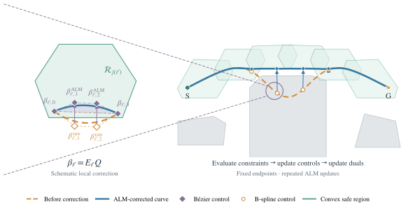

## 3 方法

### 3.1 总体框架

给定二维占据栅格 \(O\in\{0,1\}^{H\times W}\)、起点 \(S\in\mathbb R^2\) 和终点 \(G\in\mathbb R^2\)，本文生成连接起终点且满足环境安全约束的连续轨迹。占据栅格中的障碍按照智能体尺寸和安全间距进行扩张，后续几何构造与碰撞检查均在该地图上进行。轨迹采用夹持三次 B 样条表示，控制多边形记为 \(Q=[q_0,\ldots,q_{C-1}]\in\mathbb R^{C\times2}\)，连续曲线为

\[
\tau(u)=\sum_{j=0}^{C-1}B_{j,3}(u)q_j,\qquad u\in[0,1],
\]

其中，\(B_{j,3}\) 为三次 B 样条基函数。本文取 \(C=48\)，扩散状态和网络预测均定义在控制点空间。夹持节点向量满足 \(\tau(0)=q_0\)、\(\tau(1)=q_{C-1}\)，因此固定首末控制点即可施加起终点条件。

[图 3-1 原图：总体框架](figures/fig3-1_framework.drawio)

图 3-1 TrajSafe-Diffuser 总体框架。环境、带噪控制点和历史修正结果经编码与融合后，用于候选通路选择和局部安全几何预测；安全特征参与轨迹去噪，凸走廊约束用于 ALM 修正，修正结果通过 DDIM 更新和历史反馈作用于后续步骤。

总体流程如图 3-1 所示。首先，网络从占据栅格和当前带噪控制点中提取特征，并利用有效的历史修正信息补充当前控制状态。随后，根据控制特征选择任务相关通路，沿该通路预测局部安全椭圆。椭圆分支输出的隐特征作为去噪条件，其几何参数则用于构造有序凸安全走廊。最终去噪器预测干净控制点，经端点补偿后，由增广拉格朗日法（ALM）在走廊约束下进行修正。修正结果既用于更新下一步扩散状态，也被编码为下一次预测的历史条件。逆扩散结束后，将最终控制多边形解码为连续轨迹。

设扩散时间步为 \(t\)，累计信号系数为 \(\bar\alpha_t\)。训练时，仅对参考控制多边形 \(Q_0\) 的内部控制点施加高斯扰动：

\[
q_{t,j}=\sqrt{\bar\alpha_t}\,q_{0,j}
+\sqrt{1-\bar\alpha_t}\,\epsilon_j,
\qquad \epsilon_j\sim\mathcal N(0,I),\quad 1\le j\le C-2.
\]

首末控制点保持为 \(S\) 和 \(G\)。推理时，内部控制点从高斯噪声初始化，网络逐步预测干净控制多边形。以下公式省略批维，统一特征维度为 \(D=128\)，多头注意力采用 4 个头，每头维度为 32。控制点特征包含 48 个向量，安全特征包含 128 个向量，二者通过交叉注意力建立联系。

### 3.2 特征提取与融合

场景编码器通过卷积提取不同分辨率的地图特征，分别形成用于全局环境交互和局部几何查询的两种记忆。特征图展平后叠加栅格中心的位置编码，得到全局地图记忆 \(C_G\in\mathbb R^{256\times128}\) 和局部地图记忆 \(C_E\in\mathbb R^{1024\times128}\)，对应 \(16\times16\) 与 \(32\times32\) 的空间分辨率。前者用于控制特征提取和最终去噪，后者用于读取安全锚点附近的障碍结构。

带噪控制点首先经过二维坐标编码和 MLP 投影，再加入控制点索引编码：

\[
X_j^{(0)}=\operatorname{MLP}_T\bigl(\Phi_{xy}(q_{t,j})\bigr)
+\operatorname{PE}_{1D}(j).
\]

坐标编码描述空间位置，索引编码保留控制多边形的顺序。坐标投影采用 \(128\rightarrow256\rightarrow128\) 的 SiLU MLP。扩散时间步经过正弦编码和 MLP 得到 \(h_t\in\mathbb R^{128}\)，随后通过自适应层归一化（AdaLN）调制各条件注意力子层：

\[
\operatorname{AdaLN}(X,h_t)
=\bigl(1+\gamma(h_t)\bigr)\odot\operatorname{LN}(X)+\beta(h_t),
\]

其中，\(\gamma\) 和 \(\beta\) 为由时间特征生成的通道尺度与偏移，各子层使用独立的投影参数。

[图 3-2 原图：控制特征交互与历史反馈融合](figures/fig3-2_feature_fusion.drawio)

图 3-2 控制特征交互与历史反馈融合。左侧展开重复 8 次的条件注意力块，依次执行控制点自注意力、全局地图交叉注意力和前馈变换；右侧通过有效标志和逐通道门控将历史反馈加入控制特征。

如图 3-2 所示，初始控制特征经过 8 个条件注意力块。每个块依次执行自注意力、地图交叉注意力和前馈变换，并分别保留残差连接：

\[
\begin{aligned}
X'&=X+\operatorname{SA}\bigl(\operatorname{AdaLN}_1(X,h_t)\bigr),\\
X''&=X'+\operatorname{CA}\bigl(\operatorname{AdaLN}_2(X',h_t),C_G\bigr),\\
X^+&=X''+\operatorname{FFN}\bigl(\operatorname{AdaLN}_3(X'',h_t)\bigr).
\end{aligned}
\]

自注意力用于交换控制点之间的信息，并根据索引距离加入可学习的相对偏置；地图交叉注意力以控制特征为查询，以 \(C_G\) 为键和值，使控制点读取全局环境信息。前馈网络采用 \(128\rightarrow512\rightarrow128\) 的 GELU 变换。上述运算保持控制点数量与特征维度不变，输出记为 \(H_{\mathrm{ctrl}}\in\mathbb R^{48\times128}\)。

历史反馈由最近一次通过接纳检查的修正控制多边形 \(Q_{\mathrm{hist}}\)、修正量 \(\Delta Q_{\mathrm{hist}}\) 和有效标志 \(v\) 构成。对每个控制点，将二维位置、二维修正量和有效标志组成五维输入，经 \(5\rightarrow64\rightarrow128\) 的 SiLU MLP 得到反馈特征 \(H_{\mathrm{fb}}\)。门控融合为

\[
\begin{aligned}
g&=\operatorname{sigmoid}\bigl(W_g[H_{\mathrm{ctrl}};H_{\mathrm{fb}}]+b_g\bigr),\\
\widetilde H_{\mathrm{ctrl}}&=H_{\mathrm{ctrl}}+v\,g\odot H_{\mathrm{fb}}.
\end{aligned}
\]

这里仅在计算门控权重时沿通道拼接两种特征，门控输出 \(g\in\mathbb R^{48\times128}\) 为每个控制点的各通道提供独立权重。最终融合通过残差相加完成，特征维度仍为 \(48\times128\)。当 \(v=0\) 时，输出严格等于原控制特征。历史数据的生成和接纳规则在第 3.5 节说明。

### 3.3 安全特征与凸走廊生成

#### 3.3.1 通路匹配与选择

复杂非凸环境可能存在多条连接起终点的通路。本文从栅格自由空间获得候选通路集合 \(\{\Gamma_m\}_{m=1}^{M}\)，保留最多 4 条候选。每条通路使用 128 个有序点进行特征编码，同时保留完整折线用于后续弧长插值。候选坐标经过二维位置编码、独立 MLP 和索引编码，再由两层自注意力编码器提取通路特征 \(H_{S,m}\in\mathbb R^{128\times128}\)。

[图 3-3 原图：任务相关安全几何生成](figures/fig3-3_safety_geometry.drawio)

图 3-3 任务相关安全几何生成。上路通过控制特征与候选通路特征的交叉注意力完成匹配和评分；下路由所选通路生成安全查询，利用固定中心的距离偏置读取局部地图，再预测椭圆半轴和方向。

通路匹配过程如图 3-3 上路所示。以时间调制后的控制特征为查询，各候选通路特征为键和值，得到

\[
\begin{aligned}
U_m&=\widetilde H_{\mathrm{ctrl}}
+\operatorname{CA}\bigl(\operatorname{AdaLN}(\widetilde H_{\mathrm{ctrl}},h_t),H_{S,m}\bigr),\\
R_m&=U_m+\operatorname{FFN}_{\mathrm{match}}\bigl(\operatorname{LN}(U_m)\bigr).
\end{aligned}
\]

不同候选共享匹配参数，输出 \(R_m\in\mathbb R^{48\times128}\) 描述当前控制状态与该通路的关联。沿控制点轴平均池化后，评分头输出候选得分 \(\ell_m\)，并在有效候选集合 \(\mathcal V\) 内归一化：

\[
\pi_m=\frac{\exp(\ell_m)}{\sum_{k\in\mathcal V}\exp(\ell_k)},
\qquad m\in\mathcal V.
\]

推理时优先选择评分最高的候选；若该候选无法构成有效走廊，则依次尝试其余候选。走廊建立后固定所选索引 \(m^*\)，避免后续去噪条件与修正约束对应不同通路。所选完整通路与编码特征分别记为 \(\Gamma^*\) 和 \(H_S^*\)。

#### 3.3.2 局部安全几何与凸走廊

如图 3-3 下路所示，所选通路特征经过层归一化与 MLP，得到安全查询特征 \(H_\Gamma\in\mathbb R^{128\times128}\)。沿完整通路的归一化弧长均匀设置 \(N_q=128\) 个中心：

\[
c_i=\Gamma^*\left(\frac{i}{N_q-1}\right),\qquad i=0,\ldots,N_q-1.
\]

中心由通路确定，网络预测各中心处的局部尺度和方向。安全查询以 \(H_\Gamma\) 为内容特征，以局部地图记忆 \(C_E\) 为键和值。为使查询关注对应中心附近的环境，在注意力得分中加入中心距离偏置：

\[
\mathcal B_{ij}^{\mathrm{geo}}=
\operatorname{clip}\left(
-\frac{\bar\alpha_t\|c_i-z_j\|_2^2}{2\sigma_{\mathrm{geo}}^2},
-b_{\mathrm{clip}},0\right),
\]

其中，\(z_j\) 为局部地图第 \(j\) 个特征的栅格中心，\(\sigma_{\mathrm{geo}}\) 控制查询范围，\(b_{\mathrm{clip}}\) 限制偏置幅度。本文取 \(\sigma_{\mathrm{geo}}=0.25\)、\(b_{\mathrm{clip}}=8\)，距离在归一化场景坐标中计算。高噪声阶段的 \(\bar\alpha_t\) 较小，查询范围较宽；随着去噪推进，偏置增强对中心邻域的关注。交叉注意力与残差相加得到

\[
H_{\mathrm{ell}}=H_\Gamma+
\operatorname{CA}_{\mathcal B^{\mathrm{geo}}}
\bigl(\operatorname{AdaLN}(H_\Gamma,h_t),C_E\bigr).
\]

所得 \(H_{\mathrm{ell}}\in\mathbb R^{128\times128}\) 表示各安全中心处的局部环境信息。椭圆形状头对其进行时间调制，经 \(128\rightarrow256\rightarrow256\rightarrow4\) 的 SiLU MLP 输出形状参数。半轴采用对数表示，方向采用双角表示：

\[
e_i=(\log a_i,\log b_i,\cos2\theta_i,\sin2\theta_i).
\]

解码后得到半轴 \(a_i,b_i\) 和方向 \(\theta_i\)，与固定中心 \(c_i\) 共同确定安全椭圆 \(\mathcal E_i\)。双角表示与椭圆方向的 \(\pi\) 周期一致。安全特征 \(H_{\mathrm{ell}}\) 用于条件去噪；椭圆参数用于构造显式约束，二者具有不同的作用。

几何构造器结合椭圆提供的各向异性尺度、中心附近的障碍以及地图边界，建立分离半空间，得到局部凸区域

\[
\mathcal R_i=\{x\in\mathbb R^2\mid A_i x\le b_i\}.
\]

区域构造不含可学习参数。各区域经有效性、面积和相邻重叠检查后，按通路顺序组成安全走廊 \(\mathcal C\)。相邻区域重叠不足时，沿对应通路段补充桥接区域并重新检查。初始 128 个安全查询不必对应 128 个独立区域，相邻锚点可以复用区域，桥接也可能增加区域数量。

推理的前三次逆扩散前向用于预热，随后尝试建立走廊。成功激活后，所选通路、走廊几何及连续约束保持固定，后续步骤针对当前的新预测重复执行安全修正。网络仍在每个步骤计算安全隐特征；冻结的是优化所用的几何约束。

### 3.4 条件去噪与端点补偿

控制特征具有 48 个向量，安全特征具有 128 个向量。为将局部安全信息用于控制点预测，如图 3-4 第一排所示，以时间调制后的控制特征为查询，以 \(H_{\mathrm{ell}}\) 为键和值，计算

\[
U=\widetilde H_{\mathrm{ctrl}}+
\operatorname{CA}\bigl(\operatorname{AdaLN}(\widetilde H_{\mathrm{ctrl}},h_t),H_{\mathrm{ell}}\bigr),
\qquad
F=\operatorname{MLP}_{\mathrm{fuse}}(U).
\]

交叉注意力输出保留查询的控制点轴，因而 \(U\) 与 \(F\) 均为 \(48\times128\)。融合 MLP 采用层归一化及 \(128\rightarrow256\rightarrow128\) 的 GELU 变换，对残差融合后的特征进行通道变换。

[图 3-4 原图：安全条件融合、去噪与端点补偿](figures/fig3-4_denoising.drawio)

图 3-4 安全条件融合、去噪与端点补偿。第一排展示安全特征读取、残差融合、三层条件去噪块、坐标输出和固定端点补偿；第二排展开单个条件去噪块的时间调制、自注意力、地图交叉注意力和前馈残差结构。

融合特征进入三层条件去噪块，得到干净控制特征：

\[
H_{\mathrm{clean}}=\operatorname{Denoiser}(F,C_G,h_t),
\qquad
\widehat Q_{0,\mathrm{raw}}^{(t)}=H_{\mathrm{clean}}W_p+b_p.
\]

去噪块采用第 3.2 节的三子层结构，并使用独立于前端控制特征网络的参数。自注意力协调控制点之间的关系，地图交叉注意力提供全局环境信息，时间条件由各子层的 AdaLN 注入。线性输出头将每个 128 维向量映射为二维坐标，并与辅助粗控制点预测共享参数。网络预测的是干净控制多边形，而非噪声。

虽然带噪输入的首末控制点已固定，线性头仍可能产生端点偏差。直接替换两个端点会使邻近控制点无法随之协调调整，因此使用固定权重对边界误差进行局部补偿：

\[
\widehat q_{0,\mathrm{bdry},j}^{(t)}=
\widehat q_{0,\mathrm{raw},j}^{(t)}
+w_j^S\bigl(S-\widehat q_{0,\mathrm{raw},0}^{(t)}\bigr)
+w_j^G\bigl(G-\widehat q_{0,\mathrm{raw},C-1}^{(t)}\bigr).
\]

起点窗口的权重为 \((1,0.75,0.5,0.25)\)，终点窗口采用镜像权重，其余位置为零。该算子不含可学习参数，使首末控制点准确等于 \(S,G\)，同时将端点误差逐渐分配到相邻控制点。补偿后的 \(\widehat Q_{0,\mathrm{bdry}}^{(t)}\) 作为当前 ALM 修正的参考输入。

### 3.5 ALM 修正与反馈

离散轨迹点落在安全区域内，不能单独保证采样点之间的曲线安全。本文利用三次 Bézier 曲线的凸包性质，将走廊约束转换为关于原始 B 样条控制点的线性不等式。首先，根据安全锚点的归一化位置确定各凸区域的责任区间，再将责任区间边界与 B 样条节点位置合并，对曲线参数域进行细分。每段位于一个节点区间内，且仅对应一个责任区域。

设第 \(\ell\) 段为 \([u_a,u_b]\)，\(\Delta u=u_b-u_a\)，其四个 Bézier 控制点可由端点位置和导数精确提取：

\[
\begin{aligned}
\beta_{\ell,0}&=\tau(u_a),&
\beta_{\ell,1}&=\tau(u_a)+\frac{\Delta u}{3}\tau'(u_a),\\
\beta_{\ell,2}&=\tau(u_b)-\frac{\Delta u}{3}\tau'(u_b),&
\beta_{\ell,3}&=\tau(u_b).
\end{aligned}
\]

由于曲线及其导数均对 \(Q\) 线性，上式可以写为 \(\beta_\ell=E_\ell Q\)，其中 \(E_\ell\in\mathbb R^{4\times48}\)。这些控制点由 \(Q\) 计算得到，优化变量仍为原来的 48 个 B 样条控制点。细分段数取决于责任区间边界与节点的并集，不固定等于安全查询数。

若第 \(\ell\) 段对应 \(\mathcal R_{j(\ell)}\)，则连续安全约束为

\[
g_{\ell,r,f}(Q)=
a_{j(\ell),f}^{\mathsf T}(E_\ell Q)_r-b_{j(\ell),f}\le0,
\qquad r=0,1,2,3.
\]

其中，\(f\) 为区域半空间编号。整段 Bézier 曲线位于四个控制点的凸包内；当四点均位于同一凸区域时，整段曲线也位于该区域。该约束给出连续曲线归属的充分条件。对各段汇总后，记约束为 \(g(Q)=\mathcal A(Q)-b\le0\)。

图 3-5 控制点安全修正及局部 Bézier 示意。右侧展示修改前的轨迹、ALM 修正结果和控制点变化；左侧对圈出的区域作示意放大，展示修正前后的局部控制点与凸包。Bézier 控制点随原始 B 样条控制点的更新而变化，左侧形状用于说明几何关系。

以 \(Q^{\mathrm{ref}}=\widehat Q_{0,\mathrm{bdry}}^{(t)}\) 为参考，记 \(\Delta=Q-Q^{\mathrm{ref}}\)。安全修正求解

\[
\begin{aligned}
\min_Q\quad &J(\Delta)=
\frac{\lambda_p}{2}\|B\Delta\|_F^2+
\frac{\lambda_s}{2}\|D_2B\Delta\|_F^2,\\
\mathrm{s.t.}\quad &g(Q)\le0,\qquad q_0=S,\quad q_{C-1}=G.
\end{aligned}
\]

\(B\) 为用于评价修正幅度的 B 样条基矩阵，\(D_2\) 为二阶差分算子。第一项限制实际曲线位移，第二项约束修正沿曲线的变化。目标作用于修正量，避免对已可行的预测施加不必要的形状改变。这里对曲线位移的离散评价与前述连续安全约束承担不同作用。

对于非负乘子 \(\lambda\) 和罚系数 \(\rho>0\)，采用不等式增广拉格朗日函数

\[
\mathcal L_\rho(Q,\lambda)=J(Q-Q^{\mathrm{ref}})
+\frac{\|[\lambda+\rho g(Q)]_+\|_2^2-\|\lambda\|_2^2}{2\rho},
\]

其中，\([\cdot]_+\) 表示逐元素取正部。求解时，内迭代依次计算约束违规、更新内部控制点和更新乘子。令 \(\omega_k=[\lambda_k+\rho g(Q_k)]_+\)，约束梯度为 \(\mathcal A^*\omega_k\)，其中 \(\mathcal A^*\) 将半空间梯度通过提取矩阵返回原控制点。内部控制点的近端更新满足

\[
(I+\eta H_I)\Delta_I^{\mathrm{prox}}
=\bigl(\Delta_k-\eta\mathcal A^*\omega_k\bigr)_I,
\]

\(I\) 下标表示内部控制点，\(H_I\) 为修正目标对应的 Hessian。该正定系统通过 Cholesky 分解求解。更新增量经曲线位移限幅和控制点邻域平滑后，恢复固定端点，再更新乘子：

\[
\lambda_{k+1}=[\lambda_k+\rho g(Q_{k+1})]_+.
\]

本文取 \(\rho=5\)、\(\eta=0.05\)，每个引导步骤最多执行 10 次内迭代，并在冻结约束下继承跨步乘子。有限迭代可能保留约束残差，因此修正结果仍需检查。当前配置还在逆扩散结束后对残余违规结果执行一次固定端点的线性规划投影，以最小化控制点的 \(L_1\) 改变量并满足同一线性约束；已满足约束的结果保持不变，求解后再次验证可行性。

当前修正结果记为 \(Q_{0,\mathrm{ALM}}^{(t)}\)。其作用通过扩散状态更新和历史特征反馈实现。对于下一执行时间步 \(s<t\)，确定性 DDIM 使用修正后的干净预测重新计算噪声分量并更新状态：

\[
\widehat\epsilon_t=
\frac{Q_t-\sqrt{\bar\alpha_t}\,Q_{0,\mathrm{ALM}}^{(t)}}
{\sqrt{1-\bar\alpha_t}},
\qquad
Q_s=\sqrt{\bar\alpha_s}\,Q_{0,\mathrm{ALM}}^{(t)}
+\sqrt{1-\bar\alpha_s}\,\widehat\epsilon_t.
\]

更新后再次固定首末控制点。预热阶段和未激活走廊的样本使用端点补偿后的网络预测。修正结果与重新计算的噪声分量共同确定下一步状态，使安全修正能够影响后续生成。

历史反馈保存最近一次通过接纳检查的结果及其相对端点补偿后预测的改变量。具有有效约束且最大正违规量不超过反馈容差的修正结果，才更新 \(Q_{\mathrm{hist}}\)、\(\Delta Q_{\mathrm{hist}}\) 和 \(v\)。若原预测已通过检查，则保存原预测并将修正量置零；若修正仍未通过，则保留已有历史。下一次前向按照第 3.2 节的门控公式利用这些信息。反馈接纳容差取 \(10^{-2}\)，ALM 停止容差为 \(10^{-3}\)，因此有效标志表示满足历史接纳条件，而非零残差。该机制向网络传递此前的预测状态与纠偏方向，使后续去噪能够减少相同位置的重复违规。

### 3.6 损失函数与训练

#### 3.6.1 损失函数

训练同时监督控制点预测、通路选择和局部安全几何。记参考控制多边形为 \(Q_0\)，端点补偿前的最终预测为 \(\widehat Q_{0,\mathrm{raw}}\)，辅助粗预测为 \(\widehat Q_{0,\mathrm{coarse}}\)。两种预测均对内部控制点计算均方误差，最终预测的回归损失为

\[
\mathcal L_{\mathrm{ctrl}}=
\frac{1}{2(C-2)}\sum_{j=1}^{C-2}
\|\widehat q_{0,\mathrm{raw},j}-q_{0,j}\|_2^2.
\]

粗预测损失 \(\mathcal L_{\mathrm{coarse}}\) 使用相同定义。端点及其邻域通过单独的边界损失监督：以平移到当前起终点的参考局部控制多边形为目标，按照端点补偿窗口的权重计算误差。该损失约束邻近控制点的局部形状，而非将它们全部拉向端点。控制多边形平滑损失 \(\mathcal L_{\mathrm{smooth}}\) 对二阶和三阶差分进行惩罚，并以参考控制点的平均间距归一化。

通路选择采用参考轨迹与候选通路匹配得到的标签 \(m_{\mathrm{gt}}\)，其损失为 \(\mathcal L_{\mathrm{route}}=-\log\pi_{m_{\mathrm{gt}}}\)。椭圆监督包括四维形状参数回归 \(\mathcal L_{\mathrm{shape}}\)、软栅格重叠损失 \(\mathcal L_{\mathrm{IoU}}\) 以及预测椭圆与占据栅格的重叠惩罚 \(\mathcal L_{\mathrm{occ}}\)。形状和重叠监督仅作用于具有有效标签的椭圆，中心由通路确定，无需中心回归。

为使基础预测靠近走廊，对端点补偿后解码的离散曲线点 \(p_n\) 定义

\[
\mathcal L_{\mathrm{corr}}=
\frac{1}{N}\sum_{n=1}^{N}
\left[\min_i\max_f
\frac{a_{i,f}^{\mathsf T}p_n-b_{i,f}}{\|a_{i,f}\|_2}\right]_+.
\]

该项惩罚位于全部有效区域之外的曲线点。它用于基础训练，连续安全条件仍由第 3.5 节的 Bézier 约束定义。基础损失为上述各项的加权和：

\[
\begin{aligned}
\mathcal L_{\mathrm{base}}={}&
w_c\mathcal L_{\mathrm{ctrl}}+w_a\mathcal L_{\mathrm{coarse}}
+w_b\mathcal L_{\mathrm{boundary}}+w_s\mathcal L_{\mathrm{smooth}}\\
&+w_r\mathcal L_{\mathrm{route}}+w_e\mathcal L_{\mathrm{shape}}
+w_i\mathcal L_{\mathrm{IoU}}+w_o\mathcal L_{\mathrm{occ}}
+w_g\mathcal L_{\mathrm{corr}}.
\end{aligned}
\]

对于带历史反馈的第二次预测，除控制点、粗预测和边界监督外，进一步计算连续约束违规与实际曲线平滑损失。前者直接作用于第二次端点补偿后、ALM 修正前的预测：

\[
\mathcal L_{\mathrm{fb,safe}}=
\max_{\ell,r,f}\left[g_{\ell,r,f}
\bigl(\widehat Q_{0,\mathrm{bdry}}^{(2)}\bigr)\right]_+.
\]

该损失对具有有效约束包的样本求平均。曲线平滑损失 \(\mathcal L_{\mathrm{curve}}\) 将第二次预测解码后，对二阶与三阶差分进行归一化惩罚。反馈损失写为

\[
\mathcal L_{\mathrm{fb}}=
w_c\mathcal L_{\mathrm{ctrl}}^{(2)}
+w_a\mathcal L_{\mathrm{coarse}}^{(2)}
+w_b\mathcal L_{\mathrm{boundary}}^{(2)}
+w_f\mathcal L_{\mathrm{fb,safe}}
+w_p\mathcal L_{\mathrm{curve}}.
\]

第二次预测仍以参考控制多边形为回归目标，安全与平滑损失作用于网络自身的输出。

#### 3.6.2 共享参数的两次前向训练

单次随机时间步训练能够学习条件去噪，却不能提供由上一预测及其约束修正产生的历史输入。为训练反馈分支，本文在同一迭代中执行两次共享参数的网络前向，并通过实际 ALM 修正与 DDIM 更新连接两次预测。

首先，随机采样 \(t\in\{1,\ldots,T-1\}\)，对参考控制点加噪得到 \(Q_t\)，在无历史反馈的条件下执行第一次前向，并计算 \(\mathcal L_{\mathrm{base}}\)。随后，将端点补偿后的预测送入 ALM。训练使用与参考通路对应的离线走廊约束，依据修正后的违规量构造反馈有效标志，并通过一次确定性 DDIM 更新得到 \(Q_s\)，其中 \(s=t-1\)。第二次前向接收 \(Q_s\)、修正控制点、修正量及有效标志，重新预测干净控制多边形，并计算 \(\mathcal L_{\mathrm{fb}}\)。因此，第二次输入由第一次预测和修正过程共同产生。

ALM、约束检查、反馈缓存和 DDIM 状态构造均停止梯度；第二次损失只通过第二次网络前向更新共享参数。两次预测在同一迭代中联合优化，无需先训练基础模型再单独训练反馈分支。总损失为

\[
\mathcal L=\mathcal L_{\mathrm{base}}
+\omega_{\mathrm{fb}}\mathcal L_{\mathrm{fb}},
\qquad \omega_{\mathrm{fb}}=0.5.
\]

训练时使用参考通路选择，以使两次预测的安全条件与离线走廊一致。对于未通过反馈接纳检查的样本，将有效标志置零；另以 0.25 的概率屏蔽第二次前向的历史输入，使网络保留预热阶段及无可接纳历史时的生成能力。随机起始步覆盖不同噪声水平，相邻两次前向则学习历史修正对下一步预测的作用。这一训练流程与推理中的跨步反馈对应，但不需要在每次训练迭代中展开完整逆扩散链。
