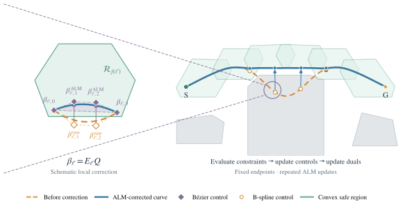

# TrajSafe-Diffuser：生成式安全约束下的扩散运动规划方法

## 摘要

扩散模型为运动规划提供了一种数据驱动的多模态轨迹生成方式，然而，其生成过程无法显式保证轨迹安全性。现有改进方法通常依赖外部提供的安全约束，而固定的约束表示难以充分适应复杂非凸环境中的空间结构变化，进而限制了扩散规划方法在复杂场景中的应用。
针对上述问题，本文提出一种生成式安全约束下的扩散运动规划方法。该方法首先利用环境结构信息自动构建与场景匹配的安全约束表示，并将其融入扩散去噪过程引导轨迹生成；随后，在逆扩散过程中引入约束优化机制对生成结果进行安全修正，并通过安全反馈机制将历史修正信息注入后续去噪步骤，从而提升复杂环境下的规划可靠性。
在处理后的 CARLA 道路场景上进行了实验验证。测试集包含 420 个样本，主实验采用 3 个随机种子重复生成，共得到 1260 条轨迹。本文方法在全部生成结果中均未发生碰撞，安全可行率达到 100%。消融实验进一步表明，走廊约束负责消除残余违规，历史反馈能够减少后续去噪步骤的重复纠偏；在当前测试协议下，4 步采样仍保持 0 次碰撞，并显著降低了推理时间。

**关键词：**扩散运动规划；生成式安全约束；凸安全走廊；闭环安全反馈；增广拉格朗日法

## 1 引言
运动规划是移动机器人、自主智能体以及具身系统实现自主决策的重要组成部分，其目标是在给定环境信息、初始状态和任务目标的条件下生成满足安全性、连续性和可执行性的运动轨迹。传统运动规划方法通常依赖显式环境模型，通过搜索、采样或优化求解获得可行路径。然而，在复杂非凸环境中，规划空间往往包含大量局部障碍结构和多种可行拓扑，仅依赖确定性规划过程难以同时兼顾轨迹多样性、安全性以及规划效率。
近年来，扩散模型凭借其强大的分布建模能力，为运动规划提供了一种新的数据驱动生成范式。通过学习轨迹数据分布，扩散模型能够在给定环境和任务条件下生成具有多模态特征的运动方案，使规划过程由传统的单一优化求解转变为基于生成模型的轨迹采样过程。然而，扩散模型本质上学习的是数据分布规律，其生成过程并不显式考虑环境安全约束，即使训练数据满足可行性要求，生成结果仍可能由于分布偏移、采样误差或复杂环境变化产生碰撞风险。
为提升扩散规划的安全性，现有研究通常通过在生成过程中引入额外安全约束或优化机制，对生成结果进行引导和修正。然而，这类方法通常依赖外部提供的安全约束表示，即假设环境中的安全区域、可行集合或约束函数已经已知。对于具有复杂非凸障碍、多拓扑通路和局部狭窄区域的环境，预先定义的安全表示往往难以充分描述实际可行空间，使得约束引导效果受到限制。因此，如何利用环境结构信息构建与任务相关的安全约束表示，减少对预定义安全约束的依赖，仍然是安全扩散规划中的一个重要挑战。
进一步而言，安全约束不仅需要满足轨迹生成过程中的可行性要求，还需要具备与环境结构相匹配的表达能力，并能够有效融入扩散采样过程。因此，理想的安全表示应能够反映自由空间结构，将复杂环境中的隐式可行区域转换为连续轨迹可验证的几何约束，并与生成模型形成有效交互。
针对上述问题，本文提出 TrajSafe-Diffuser，一种生成式安全约束下的扩散运动规划方法。该方法首先利用环境结构信息生成与当前任务匹配的安全约束表示，将复杂非凸自由空间转换为适用于连续轨迹规划的局部安全区域。随后，将生成的安全约束作为条件信息融入扩散去噪过程，使轨迹生成过程能够同时考虑运动分布和安全可行性。在推理阶段，引入约束优化机制对当前生成结果进行安全修正，并将历史修正信息反馈至后续去噪步骤，实现安全约束与扩散生成过程的闭环融合。
本文的主要贡献如下：
（1）提出一种面向扩散运动规划的生成式安全约束构建方法。该方法根据环境结构信息自动生成任务相关的安全约束表示，使复杂环境中的安全可行空间能够被显式建模并用于后续轨迹生成。
（2）提出安全约束与扩散规划融合的方法。通过将生成的安全几何表示融入轨迹去噪过程，引导扩散模型生成满足安全约束的运动轨迹，而非仅依赖后处理修正。
（3）提出闭环安全修正机制。通过在逆扩散过程中引入约束优化，并将修正结果反馈至后续生成步骤，使安全约束能够持续影响轨迹生成过程，提高复杂环境下规划的可靠性。

## 2 相关工作
扩散运动规划将轨迹作为整体生成对象，通过迭代去噪与任务条件建模多模态运动分布。环境编码、目标条件和代价引导进一步增强了生成结果对场景与任务的适应性。然而，分布学习与约束满足是不同问题：训练示范可行并不意味着每次随机采样都可行，因此仍需显式处理生成过程中的安全约束。

安全扩散规划通过控制屏障函数、惩罚引导、投影或原始—对偶优化，将安全要求融入逆扩散过程。这类方法重点解决给定安全函数或可行集合下的受约束生成。本文关注与之互补的问题：如何从复杂非凸环境中构建任务相关的几何约束，并使约束修正的信息参与后续去噪，而非仅对各步预测独立纠偏。

凸几何规划通过障碍分离与局部区域构造，将自由空间表示为可供连续轨迹优化使用的凸集合；区域图进一步描述局部集合之间的连通关系。本文沿用凸区域便于验证连续曲线的几何性质，但不以独立的全局区域分解替代生成模型，而是由任务相关骨架与学习到的局部尺度组织连续走廊，并将几何特征、约束优化和历史反馈统一到扩散采样中。

## 3 方法

### 3.1 总体框架

给定二维占据栅格 \(O\in\{0,1\}^{H\times W}\)、起点 \(S\in\mathbb R^2\) 和终点 \(G\in\mathbb R^2\)，本文生成连接起终点且满足环境安全约束的连续轨迹。占据栅格中的障碍按照智能体尺寸和安全间距进行扩张，后续几何构造与碰撞检查均在该地图上进行。轨迹采用夹持三次 B 样条表示，控制多边形记为 \(Q=[q_0,\ldots,q_{C-1}]\in\mathbb R^{C\times2}\)，连续曲线为

\[
\tau(u)=\sum_{j=0}^{C-1}B_{j,3}(u)q_j,\qquad u\in[0,1],
\]

其中，\(B_{j,3}\) 为三次 B 样条基函数。本文取 \(C=48\)，扩散状态和网络预测均定义在控制点空间。夹持节点向量满足 \(\tau(0)=q_0\)、\(\tau(1)=q_{C-1}\)，因此固定首末控制点即可施加起终点条件。

[图 3-1 原图：总体框架](figures/fig3-1_framework.drawio)

图 3-1 TrajSafe-Diffuser 总体框架。环境、带噪控制点和历史修正结果经编码与融合后，用于候选通路选择和局部安全几何预测；安全特征参与轨迹去噪，凸走廊约束用于 ALM 修正，修正结果通过 DDIM 更新和历史反馈作用于后续步骤。

总体流程如图 3-1 所示。首先，网络从占据栅格和当前带噪控制点中提取特征，并利用有效的历史修正信息补充当前控制状态。随后，根据控制特征选择任务相关通路，沿该通路预测局部安全椭圆。椭圆分支输出的隐特征作为去噪条件，其几何参数则用于构造有序凸安全走廊。最终去噪器预测干净控制点，经端点补偿后，由增广拉格朗日法（ALM）在走廊约束下进行修正。修正结果既用于更新下一步扩散状态，也被编码为下一次预测的历史条件。逆扩散结束后，将最终控制多边形解码为连续轨迹。

设扩散时间步为 \(t\)，累计信号系数为 \(\bar\alpha_t\)。训练时，仅对参考控制多边形 \(Q_0\) 的内部控制点施加高斯扰动：

\[
q_{t,j}=\sqrt{\bar\alpha_t}\,q_{0,j}
+\sqrt{1-\bar\alpha_t}\,\epsilon_j,
\qquad \epsilon_j\sim\mathcal N(0,I),\quad 1\le j\le C-2.
\]

首末控制点保持为 \(S\) 和 \(G\)。推理时，内部控制点从高斯噪声初始化，网络逐步预测干净控制多边形。以下公式省略批维，统一特征维度为 \(D=128\)，多头注意力采用 4 个头，每头维度为 32。控制点特征包含 48 个向量，安全特征包含 128 个向量，二者通过交叉注意力建立联系。

### 3.2 特征提取与融合

场景编码器通过卷积提取不同分辨率的地图特征，分别形成用于全局环境交互和局部几何查询的两种记忆。特征图展平后叠加栅格中心的位置编码，得到全局地图记忆 \(C_G\in\mathbb R^{256\times128}\) 和局部地图记忆 \(C_E\in\mathbb R^{1024\times128}\)，对应 \(16\times16\) 与 \(32\times32\) 的空间分辨率。前者用于控制特征提取和最终去噪，后者用于读取安全锚点附近的障碍结构。

带噪控制点首先经过二维坐标编码和 MLP 投影，再加入控制点索引编码：

\[
X_j^{(0)}=\operatorname{MLP}_T\bigl(\Phi_{xy}(q_{t,j})\bigr)
+\operatorname{PE}_{1D}(j).
\]

坐标编码描述空间位置，索引编码保留控制多边形的顺序。坐标投影采用 \(128\rightarrow256\rightarrow128\) 的 SiLU MLP。扩散时间步经过正弦编码和 MLP 得到 \(h_t\in\mathbb R^{128}\)，随后通过自适应层归一化（AdaLN）调制各条件注意力子层：

\[
\operatorname{AdaLN}(X,h_t)
=\bigl(1+\gamma(h_t)\bigr)\odot\operatorname{LN}(X)+\beta(h_t),
\]

其中，\(\gamma\) 和 \(\beta\) 为由时间特征生成的通道尺度与偏移，各子层使用独立的投影参数。

[图 3-2 原图：控制特征交互与历史反馈融合](figures/fig3-2_feature_fusion.drawio)

图 3-2 控制特征交互与历史反馈融合。左侧展开重复 8 次的条件注意力块，依次执行控制点自注意力、全局地图交叉注意力和前馈变换；右侧通过有效标志和逐通道门控将历史反馈加入控制特征。

如图 3-2 所示，初始控制特征经过 8 个条件注意力块。每个块依次执行自注意力、地图交叉注意力和前馈变换，并分别保留残差连接：

\[
\begin{aligned}
X'&=X+\operatorname{SA}\bigl(\operatorname{AdaLN}_1(X,h_t)\bigr),\\
X''&=X'+\operatorname{CA}\bigl(\operatorname{AdaLN}_2(X',h_t),C_G\bigr),\\
X^+&=X''+\operatorname{FFN}\bigl(\operatorname{AdaLN}_3(X'',h_t)\bigr).
\end{aligned}
\]

自注意力用于交换控制点之间的信息，并根据索引距离加入可学习的相对偏置；地图交叉注意力以控制特征为查询，以 \(C_G\) 为键和值，使控制点读取全局环境信息。前馈网络采用 \(128\rightarrow512\rightarrow128\) 的 GELU 变换。上述运算保持控制点数量与特征维度不变，输出记为 \(H_{\mathrm{ctrl}}\in\mathbb R^{48\times128}\)。

历史反馈由最近一次通过接纳检查的修正控制多边形 \(Q_{\mathrm{hist}}\)、修正量 \(\Delta Q_{\mathrm{hist}}\) 和有效标志 \(v\) 构成。对每个控制点，将二维位置、二维修正量和有效标志组成五维输入，经 \(5\rightarrow64\rightarrow128\) 的 SiLU MLP 得到反馈特征 \(H_{\mathrm{fb}}\)。门控融合为

\[
\begin{aligned}
g&=\operatorname{sigmoid}\bigl(W_g[H_{\mathrm{ctrl}};H_{\mathrm{fb}}]+b_g\bigr),\\
\widetilde H_{\mathrm{ctrl}}&=H_{\mathrm{ctrl}}+v\,g\odot H_{\mathrm{fb}}.
\end{aligned}
\]

这里仅在计算门控权重时沿通道拼接两种特征，门控输出 \(g\in\mathbb R^{48\times128}\) 为每个控制点的各通道提供独立权重。最终融合通过残差相加完成，特征维度仍为 \(48\times128\)。当 \(v=0\) 时，输出严格等于原控制特征。历史数据的生成和接纳规则在第 3.5 节说明。

### 3.3 安全特征与凸走廊生成

#### 3.3.1 通路匹配与选择

复杂非凸环境可能存在多条连接起终点的通路。本文从栅格自由空间获得候选通路集合 \(\{\Gamma_m\}_{m=1}^{M}\)，保留最多 4 条候选。每条通路使用 128 个有序点进行特征编码，同时保留完整折线用于后续弧长插值。候选坐标经过二维位置编码、独立 MLP 和索引编码，再由两层自注意力编码器提取通路特征 \(H_{S,m}\in\mathbb R^{128\times128}\)。

[图 3-3 原图：任务相关安全几何生成](figures/fig3-3_safety_geometry.drawio)

图 3-3 任务相关安全几何生成。上路通过控制特征与候选通路特征的交叉注意力完成匹配和评分；下路由所选通路生成安全查询，利用固定中心的距离偏置读取局部地图，再预测椭圆半轴和方向。

通路匹配过程如图 3-3 上路所示。以时间调制后的控制特征为查询，各候选通路特征为键和值，得到

\[
\begin{aligned}
U_m&=\widetilde H_{\mathrm{ctrl}}
+\operatorname{CA}\bigl(\operatorname{AdaLN}(\widetilde H_{\mathrm{ctrl}},h_t),H_{S,m}\bigr),\\
R_m&=U_m+\operatorname{FFN}_{\mathrm{match}}\bigl(\operatorname{LN}(U_m)\bigr).
\end{aligned}
\]

不同候选共享匹配参数，输出 \(R_m\in\mathbb R^{48\times128}\) 描述当前控制状态与该通路的关联。沿控制点轴平均池化后，评分头输出候选得分 \(\ell_m\)，并在有效候选集合 \(\mathcal V\) 内归一化：

\[
\pi_m=\frac{\exp(\ell_m)}{\sum_{k\in\mathcal V}\exp(\ell_k)},
\qquad m\in\mathcal V.
\]

推理时优先选择评分最高的候选；若该候选无法构成有效走廊，则依次尝试其余候选。走廊建立后固定所选索引 \(m^*\)，避免后续去噪条件与修正约束对应不同通路。所选完整通路与编码特征分别记为 \(\Gamma^*\) 和 \(H_S^*\)。

#### 3.3.2 局部安全几何与凸走廊

如图 3-3 下路所示，所选通路特征经过层归一化与 MLP，得到安全查询特征 \(H_\Gamma\in\mathbb R^{128\times128}\)。沿完整通路的归一化弧长均匀设置 \(N_q=128\) 个中心：

\[
c_i=\Gamma^*\left(\frac{i}{N_q-1}\right),\qquad i=0,\ldots,N_q-1.
\]

中心由通路确定，网络预测各中心处的局部尺度和方向。安全查询以 \(H_\Gamma\) 为内容特征，以局部地图记忆 \(C_E\) 为键和值。为使查询关注对应中心附近的环境，在注意力得分中加入中心距离偏置：

\[
\mathcal B_{ij}^{\mathrm{geo}}=
\operatorname{clip}\left(
-\frac{\bar\alpha_t\|c_i-z_j\|_2^2}{2\sigma_{\mathrm{geo}}^2},
-b_{\mathrm{clip}},0\right),
\]

其中，\(z_j\) 为局部地图第 \(j\) 个特征的栅格中心，\(\sigma_{\mathrm{geo}}\) 控制查询范围，\(b_{\mathrm{clip}}\) 限制偏置幅度。本文取 \(\sigma_{\mathrm{geo}}=0.25\)、\(b_{\mathrm{clip}}=8\)，距离在归一化场景坐标中计算。高噪声阶段的 \(\bar\alpha_t\) 较小，查询范围较宽；随着去噪推进，偏置增强对中心邻域的关注。交叉注意力与残差相加得到

\[
H_{\mathrm{ell}}=H_\Gamma+
\operatorname{CA}_{\mathcal B^{\mathrm{geo}}}
\bigl(\operatorname{AdaLN}(H_\Gamma,h_t),C_E\bigr).
\]

所得 \(H_{\mathrm{ell}}\in\mathbb R^{128\times128}\) 表示各安全中心处的局部环境信息。椭圆形状头对其进行时间调制，经 \(128\rightarrow256\rightarrow256\rightarrow4\) 的 SiLU MLP 输出形状参数。半轴采用对数表示，方向采用双角表示：

\[
e_i=(\log a_i,\log b_i,\cos2\theta_i,\sin2\theta_i).
\]

解码后得到半轴 \(a_i,b_i\) 和方向 \(\theta_i\)，与固定中心 \(c_i\) 共同确定安全椭圆 \(\mathcal E_i\)。双角表示与椭圆方向的 \(\pi\) 周期一致。安全特征 \(H_{\mathrm{ell}}\) 用于条件去噪；椭圆参数用于构造显式约束，二者具有不同的作用。

几何构造器结合椭圆提供的各向异性尺度、中心附近的障碍以及地图边界，建立分离半空间，得到局部凸区域

\[
\mathcal R_i=\{x\in\mathbb R^2\mid A_i x\le b_i\}.
\]

区域构造不含可学习参数。各区域经有效性、面积和相邻重叠检查后，按通路顺序组成安全走廊 \(\mathcal C\)。相邻区域重叠不足时，沿对应通路段补充桥接区域并重新检查。初始 128 个安全查询不必对应 128 个独立区域，相邻锚点可以复用区域，桥接也可能增加区域数量。

推理的前三次逆扩散前向用于预热，随后尝试建立走廊。成功激活后，所选通路、走廊几何及连续约束保持固定，后续步骤针对当前的新预测重复执行安全修正。网络仍在每个步骤计算安全隐特征；冻结的是优化所用的几何约束。

### 3.4 条件去噪与端点补偿

控制特征具有 48 个向量，安全特征具有 128 个向量。为将局部安全信息用于控制点预测，如图 3-4 第一排所示，以时间调制后的控制特征为查询，以 \(H_{\mathrm{ell}}\) 为键和值，计算

\[
U=\widetilde H_{\mathrm{ctrl}}+
\operatorname{CA}\bigl(\operatorname{AdaLN}(\widetilde H_{\mathrm{ctrl}},h_t),H_{\mathrm{ell}}\bigr),
\qquad
F=\operatorname{MLP}_{\mathrm{fuse}}(U).
\]

交叉注意力输出保留查询的控制点轴，因而 \(U\) 与 \(F\) 均为 \(48\times128\)。融合 MLP 采用层归一化及 \(128\rightarrow256\rightarrow128\) 的 GELU 变换，对残差融合后的特征进行通道变换。

[图 3-4 原图：安全条件融合、去噪与端点补偿](figures/fig3-4_denoising.drawio)

图 3-4 安全条件融合、去噪与端点补偿。第一排展示安全特征读取、残差融合、三层条件去噪块、坐标输出和固定端点补偿；第二排展开单个条件去噪块的时间调制、自注意力、地图交叉注意力和前馈残差结构。

融合特征进入三层条件去噪块，得到干净控制特征：

\[
H_{\mathrm{clean}}=\operatorname{Denoiser}(F,C_G,h_t),
\qquad
\widehat Q_{0,\mathrm{raw}}^{(t)}=H_{\mathrm{clean}}W_p+b_p.
\]

去噪块采用第 3.2 节的三子层结构，并使用独立于前端控制特征网络的参数。自注意力协调控制点之间的关系，地图交叉注意力提供全局环境信息，时间条件由各子层的 AdaLN 注入。线性输出头将每个 128 维向量映射为二维坐标，并与辅助粗控制点预测共享参数。网络预测的是干净控制多边形，而非噪声。

虽然带噪输入的首末控制点已固定，线性头仍可能产生端点偏差。直接替换两个端点会使邻近控制点无法随之协调调整，因此使用固定权重对边界误差进行局部补偿：

\[
\widehat q_{0,\mathrm{bdry},j}^{(t)}=
\widehat q_{0,\mathrm{raw},j}^{(t)}
+w_j^S\bigl(S-\widehat q_{0,\mathrm{raw},0}^{(t)}\bigr)
+w_j^G\bigl(G-\widehat q_{0,\mathrm{raw},C-1}^{(t)}\bigr).
\]

起点窗口的权重为 \((1,0.75,0.5,0.25)\)，终点窗口采用镜像权重，其余位置为零。该算子不含可学习参数，使首末控制点准确等于 \(S,G\)，同时将端点误差逐渐分配到相邻控制点。补偿后的 \(\widehat Q_{0,\mathrm{bdry}}^{(t)}\) 作为当前 ALM 修正的参考输入。

### 3.5 ALM 修正与反馈

离散轨迹点落在安全区域内，不能单独保证采样点之间的曲线安全。本文利用三次 Bézier 曲线的凸包性质，将走廊约束转换为关于原始 B 样条控制点的线性不等式。首先，根据安全锚点的归一化位置确定各凸区域的责任区间，再将责任区间边界与 B 样条节点位置合并，对曲线参数域进行细分。每段位于一个节点区间内，且仅对应一个责任区域。

设第 \(\ell\) 段为 \([u_a,u_b]\)，\(\Delta u=u_b-u_a\)，其四个 Bézier 控制点可由端点位置和导数精确提取：

\[
\begin{aligned}
\beta_{\ell,0}&=\tau(u_a),&
\beta_{\ell,1}&=\tau(u_a)+\frac{\Delta u}{3}\tau'(u_a),\\
\beta_{\ell,2}&=\tau(u_b)-\frac{\Delta u}{3}\tau'(u_b),&
\beta_{\ell,3}&=\tau(u_b).
\end{aligned}
\]

由于曲线及其导数均对 \(Q\) 线性，上式可以写为 \(\beta_\ell=E_\ell Q\)，其中 \(E_\ell\in\mathbb R^{4\times48}\)。这些控制点由 \(Q\) 计算得到，优化变量仍为原来的 48 个 B 样条控制点。细分段数取决于责任区间边界与节点的并集，不固定等于安全查询数。

若第 \(\ell\) 段对应 \(\mathcal R_{j(\ell)}\)，则连续安全约束为

\[
g_{\ell,r,f}(Q)=
a_{j(\ell),f}^{\mathsf T}(E_\ell Q)_r-b_{j(\ell),f}\le0,
\qquad r=0,1,2,3.
\]

其中，\(f\) 为区域半空间编号。整段 Bézier 曲线位于四个控制点的凸包内；当四点均位于同一凸区域时，整段曲线也位于该区域。该约束给出连续曲线归属的充分条件。对各段汇总后，记约束为 \(g(Q)=\mathcal A(Q)-b\le0\)。

图 3-5 控制点安全修正及局部 Bézier 示意。右侧展示修改前的轨迹、ALM 修正结果和控制点变化；左侧对圈出的区域作示意放大，展示修正前后的局部控制点与凸包。Bézier 控制点随原始 B 样条控制点的更新而变化，左侧形状用于说明几何关系。

以 \(Q^{\mathrm{ref}}=\widehat Q_{0,\mathrm{bdry}}^{(t)}\) 为参考，记 \(\Delta=Q-Q^{\mathrm{ref}}\)。安全修正求解

\[
\begin{aligned}
\min_Q\quad &J(\Delta)=
\frac{\lambda_p}{2}\|B\Delta\|_F^2+
\frac{\lambda_s}{2}\|D_2B\Delta\|_F^2,\\
\mathrm{s.t.}\quad &g(Q)\le0,\qquad q_0=S,\quad q_{C-1}=G.
\end{aligned}
\]

\(B\) 为用于评价修正幅度的 B 样条基矩阵，\(D_2\) 为二阶差分算子。第一项限制实际曲线位移，第二项约束修正沿曲线的变化。目标作用于修正量，避免对已可行的预测施加不必要的形状改变。这里对曲线位移的离散评价与前述连续安全约束承担不同作用。

对于非负乘子 \(\lambda\) 和罚系数 \(\rho>0\)，采用不等式增广拉格朗日函数

\[
\mathcal L_\rho(Q,\lambda)=J(Q-Q^{\mathrm{ref}})
+\frac{\|[\lambda+\rho g(Q)]_+\|_2^2-\|\lambda\|_2^2}{2\rho},
\]

其中，\([\cdot]_+\) 表示逐元素取正部。求解时，内迭代依次计算约束违规、更新内部控制点和更新乘子。令 \(\omega_k=[\lambda_k+\rho g(Q_k)]_+\)，约束梯度为 \(\mathcal A^*\omega_k\)，其中 \(\mathcal A^*\) 将半空间梯度通过提取矩阵返回原控制点。内部控制点的近端更新满足

\[
(I+\eta H_I)\Delta_I^{\mathrm{prox}}
=\bigl(\Delta_k-\eta\mathcal A^*\omega_k\bigr)_I,
\]

\(I\) 下标表示内部控制点，\(H_I\) 为修正目标对应的 Hessian。该正定系统通过 Cholesky 分解求解。更新增量经曲线位移限幅和控制点邻域平滑后，恢复固定端点，再更新乘子：

\[
\lambda_{k+1}=[\lambda_k+\rho g(Q_{k+1})]_+.
\]

本文取 \(\rho=5\)、\(\eta=0.05\)，每个引导步骤最多执行 10 次内迭代，并在冻结约束下继承跨步乘子。有限迭代可能保留约束残差，因此修正结果仍需检查。当前配置还在逆扩散结束后对残余违规结果执行一次固定端点的线性规划投影，以最小化控制点的 \(L_1\) 改变量并满足同一线性约束；已满足约束的结果保持不变，求解后再次验证可行性。

当前修正结果记为 \(Q_{0,\mathrm{ALM}}^{(t)}\)。其作用通过扩散状态更新和历史特征反馈实现。对于下一执行时间步 \(s<t\)，确定性 DDIM 使用修正后的干净预测重新计算噪声分量并更新状态：

\[
\widehat\epsilon_t=
\frac{Q_t-\sqrt{\bar\alpha_t}\,Q_{0,\mathrm{ALM}}^{(t)}}
{\sqrt{1-\bar\alpha_t}},
\qquad
Q_s=\sqrt{\bar\alpha_s}\,Q_{0,\mathrm{ALM}}^{(t)}
+\sqrt{1-\bar\alpha_s}\,\widehat\epsilon_t.
\]

更新后再次固定首末控制点。预热阶段和未激活走廊的样本使用端点补偿后的网络预测。修正结果与重新计算的噪声分量共同确定下一步状态，使安全修正能够影响后续生成。

历史反馈保存最近一次通过接纳检查的结果及其相对端点补偿后预测的改变量。具有有效约束且最大正违规量不超过反馈容差的修正结果，才更新 \(Q_{\mathrm{hist}}\)、\(\Delta Q_{\mathrm{hist}}\) 和 \(v\)。若原预测已通过检查，则保存原预测并将修正量置零；若修正仍未通过，则保留已有历史。下一次前向按照第 3.2 节的门控公式利用这些信息。反馈接纳容差取 \(10^{-2}\)，ALM 停止容差为 \(10^{-3}\)，因此有效标志表示满足历史接纳条件，而非零残差。该机制向网络传递此前的预测状态与纠偏方向，使后续去噪能够减少相同位置的重复违规。

### 3.6 损失函数与训练

#### 3.6.1 损失函数

训练同时监督控制点预测、通路选择和局部安全几何。记参考控制多边形为 \(Q_0\)，端点补偿前的最终预测为 \(\widehat Q_{0,\mathrm{raw}}\)，辅助粗预测为 \(\widehat Q_{0,\mathrm{coarse}}\)。两种预测均对内部控制点计算均方误差，最终预测的回归损失为

\[
\mathcal L_{\mathrm{ctrl}}=
\frac{1}{2(C-2)}\sum_{j=1}^{C-2}
\|\widehat q_{0,\mathrm{raw},j}-q_{0,j}\|_2^2.
\]

粗预测损失 \(\mathcal L_{\mathrm{coarse}}\) 使用相同定义。端点及其邻域通过单独的边界损失监督：以平移到当前起终点的参考局部控制多边形为目标，按照端点补偿窗口的权重计算误差。该损失约束邻近控制点的局部形状，而非将它们全部拉向端点。控制多边形平滑损失 \(\mathcal L_{\mathrm{smooth}}\) 对二阶和三阶差分进行惩罚，并以参考控制点的平均间距归一化。

通路选择采用参考轨迹与候选通路匹配得到的标签 \(m_{\mathrm{gt}}\)，其损失为 \(\mathcal L_{\mathrm{route}}=-\log\pi_{m_{\mathrm{gt}}}\)。椭圆监督包括四维形状参数回归 \(\mathcal L_{\mathrm{shape}}\)、软栅格重叠损失 \(\mathcal L_{\mathrm{IoU}}\) 以及预测椭圆与占据栅格的重叠惩罚 \(\mathcal L_{\mathrm{occ}}\)。形状和重叠监督仅作用于具有有效标签的椭圆，中心由通路确定，无需中心回归。

为使基础预测靠近走廊，对端点补偿后解码的离散曲线点 \(p_n\) 定义

\[
\mathcal L_{\mathrm{corr}}=
\frac{1}{N}\sum_{n=1}^{N}
\left[\min_i\max_f
\frac{a_{i,f}^{\mathsf T}p_n-b_{i,f}}{\|a_{i,f}\|_2}\right]_+.
\]

该项惩罚位于全部有效区域之外的曲线点。它用于基础训练，连续安全条件仍由第 3.5 节的 Bézier 约束定义。基础损失为上述各项的加权和：

\[
\begin{aligned}
\mathcal L_{\mathrm{base}}={}&
w_c\mathcal L_{\mathrm{ctrl}}+w_a\mathcal L_{\mathrm{coarse}}
+w_b\mathcal L_{\mathrm{boundary}}+w_s\mathcal L_{\mathrm{smooth}}\\
&+w_r\mathcal L_{\mathrm{route}}+w_e\mathcal L_{\mathrm{shape}}
+w_i\mathcal L_{\mathrm{IoU}}+w_o\mathcal L_{\mathrm{occ}}
+w_g\mathcal L_{\mathrm{corr}}.
\end{aligned}
\]

对于带历史反馈的第二次预测，除控制点、粗预测和边界监督外，进一步计算连续约束违规与实际曲线平滑损失。前者直接作用于第二次端点补偿后、ALM 修正前的预测：

\[
\mathcal L_{\mathrm{fb,safe}}=
\max_{\ell,r,f}\left[g_{\ell,r,f}
\bigl(\widehat Q_{0,\mathrm{bdry}}^{(2)}\bigr)\right]_+.
\]

该损失对具有有效约束包的样本求平均。曲线平滑损失 \(\mathcal L_{\mathrm{curve}}\) 将第二次预测解码后，对二阶与三阶差分进行归一化惩罚。反馈损失写为

\[
\mathcal L_{\mathrm{fb}}=
w_c\mathcal L_{\mathrm{ctrl}}^{(2)}
+w_a\mathcal L_{\mathrm{coarse}}^{(2)}
+w_b\mathcal L_{\mathrm{boundary}}^{(2)}
+w_f\mathcal L_{\mathrm{fb,safe}}
+w_p\mathcal L_{\mathrm{curve}}.
\]

第二次预测仍以参考控制多边形为回归目标，安全与平滑损失作用于网络自身的输出。

#### 3.6.2 共享参数的两次前向训练

单次随机时间步训练能够学习条件去噪，却不能提供由上一预测及其约束修正产生的历史输入。为训练反馈分支，本文在同一迭代中执行两次共享参数的网络前向，并通过实际 ALM 修正与 DDIM 更新连接两次预测。

首先，随机采样 \(t\in\{1,\ldots,T-1\}\)，对参考控制点加噪得到 \(Q_t\)，在无历史反馈的条件下执行第一次前向，并计算 \(\mathcal L_{\mathrm{base}}\)。随后，将端点补偿后的预测送入 ALM。训练使用与参考通路对应的离线走廊约束，依据修正后的违规量构造反馈有效标志，并通过一次确定性 DDIM 更新得到 \(Q_s\)，其中 \(s=t-1\)。第二次前向接收 \(Q_s\)、修正控制点、修正量及有效标志，重新预测干净控制多边形，并计算 \(\mathcal L_{\mathrm{fb}}\)。因此，第二次输入由第一次预测和修正过程共同产生。

ALM、约束检查、反馈缓存和 DDIM 状态构造均停止梯度；第二次损失只通过第二次网络前向更新共享参数。两次预测在同一迭代中联合优化，无需先训练基础模型再单独训练反馈分支。总损失为

\[
\mathcal L=\mathcal L_{\mathrm{base}}
+\omega_{\mathrm{fb}}\mathcal L_{\mathrm{fb}},
\qquad \omega_{\mathrm{fb}}=0.5.
\]

训练时使用参考通路选择，以使两次预测的安全条件与离线走廊一致。对于未通过反馈接纳检查的样本，将有效标志置零；另以 0.25 的概率屏蔽第二次前向的历史输入，使网络保留预热阶段及无可接纳历史时的生成能力。随机起始步覆盖不同噪声水平，相邻两次前向则学习历史修正对下一步预测的作用。这一训练流程与推理中的跨步反馈对应，但不需要在每次训练迭代中展开完整逆扩散链。

## 4 实验与结果分析

本文从整体安全性、关键组件贡献和推理效率三个方面评价 TrajSafe-Diffuser。测试集包含 420 个样本；主对比对每个样本使用 3 个随机种子，共生成 1260 条轨迹，消融与效率实验固定一个随机种子，各评价 420 条轨迹。除特别说明外，均采用 16 步 DDIM。

### 4.1 实验设置

#### 4.1.1 数据集与实现设置

实验采用 CARLA 栅格轨迹数据集。每个场景表示为覆盖 \(160\ \mathrm{m}\times160\ \mathrm{m}\) 的 \(256\times256\) 占据栅格，分辨率为 \(0.625\ \mathrm{m/grid}\)；障碍物周围扩张 4 个栅格，地图边界按不可行区域处理。训练集由 Town03、Town04 的 3850 个样本组成，验证集包含 Town05 的 1550 个样本，测试集包含 Town01、Town02 和 Town10HD 的 420 个样本，测试城镇不参与训练。数据划分及评价规模见图 4-1。

图 4-1 数据划分与评价协议。（a）训练、验证和测试采用互不重叠的城镇集合；柱长表示各集合的样本数，不表示单个城镇的样本数。（b）主对比对同一测试集使用 3 个生成随机种子，每种方法评价 1260 条轨迹；消融与效率实验各使用一个种子，每种配置评价 420 条轨迹。重复生成不增加独立测试样本数。

轨迹由 48 个三次 B 样条控制点表示，走廊约束和 ALM 均直接修正控制点，最终碰撞检测在曲线上等参数采样 512 个点。约束生成保留 4 条候选拓扑；16 步采样的前 3 个反向步骤用于预热，此后激活安全引导。本文所有安全指标均相对于扩张后的二维占据栅格定义。

#### 4.1.2 对比方法

| 方法 | 推理期安全处理 |
|---|---|
| 无约束扩散 | 不施加安全修正 |
| 固定惩罚引导 | 沿固定权重的 SDF 碰撞代价梯度更新轨迹 |
| 局部线性化投影 | 将预测投影至当前点附近的线性化可行半空间 |
| 原始—对偶引导 | 交替更新轨迹变量与 SDF 约束乘子 |
| SDF 增广拉格朗日引导 | 在原始—对偶目标中加入二次违规罚项 |
| TrajSafe-Diffuser | 生成连续凸走廊，并执行控制点 ALM、历史反馈与安全状态更新 |

前五种方法共享基础扩散生成器、初始噪声、SDF 实现和 10 次内迭代预算；TrajSafe-Diffuser 使用闭环安全反馈生成器。因此，前五种方法构成同生成先验下的处理器比较，完整方法与其比较反映端到端系统差异。

#### 4.1.3 评价指标

安全性采用碰撞率、SDF 可行率、平均与 P95 约束违规量以及最小安全距离评价。碰撞率依据占据栅格检查，SDF 可行率依据距离场约束，两者判据不同，不能直接视为互补比例；P95 违规量用于观察尾部风险，负安全距离表示侵入障碍。轨迹质量采用相对参考轨迹的 RMSE 和二阶变化量定义的平滑度评价，后者越小表示局部变化越平缓。效率采用统一批量计时边界下的平均单轨迹生成时间。各指标的单位与优化方向列于表头；重新设置起终点的案例不具有对应参考轨迹，故不报告 RMSE。

### 4.2 不同安全约束方法比较

#### 4.2.1 整体结果与安全性分析

表 4-1 汇总了 3 个随机种子上的总体结果。每种方法均针对同一组 420 个测试样本重复生成 3 次，共计 1260 条轨迹。

表 4-1 不同安全约束方法的安全性与轨迹质量

| 方法 | 生成模型配置 | 碰撞率/% ↓ | SDF 可行率/% ↑ | 平均违规/m ↓ | P95 违规/m ↓ | 最小安全距离/m ↑ | RMSE/m ↓ | 平滑度/m ↓ |
|---|---|---:|---:|---:|---:|---:|---:|---:|
| 无约束扩散 | 基础扩散生成器 | 67.46 | 33.17 | 7.634 | 25.412 | -6.806 | 15.70 | 0.0274 |
| 固定惩罚引导 | 基础扩散生成器 | **17.46** | **87.06** | **2.233** | **20.919** | **-1.145** | 14.27 | 0.1543 |
| 局部线性化投影 | 基础扩散生成器 | 65.79 | 56.27 | 2.720 | 22.174 | -1.876 | 14.31 | 0.1204 |
| 原始—对偶引导 | 基础扩散生成器 | 20.56 | 79.76 | 3.776 | 24.051 | -2.702 | 14.19 | 0.1071 |
| SDF 增广拉格朗日引导 | 基础扩散生成器 | 19.05 | 81.03 | 3.645 | 23.394 | -2.595 | 14.15 | 0.0905 |
| **TrajSafe-Diffuser** | 闭环安全反馈生成器 | **0.00** | **100.00** | **0.000** | **0.000** | **3.246** | **10.47** | **0.0297** |

无约束扩散在 1260 条生成轨迹中发生 850 次碰撞，说明即使模型从可行示范中学习到了轨迹分布，随机生成结果也不会自动获得安全保证。四种外部距离场方法均在一定程度上减少了约束违规。其中，固定惩罚引导取得了前五种方法中最低的碰撞率和最高的可行率，但仍有 17.46% 的轨迹发生碰撞，且 P95 违规量达到 20.919 m。这表明统一惩罚权重能够改善多数普通样本，却难以稳定处理偏离可行空间较远的尾部样本。

局部线性化投影将平均违规量降至 2.720 m，但碰撞率仅由 67.46% 降至 65.79%，说明降低平均违规并不必然消除碰撞。非凸距离场的局部近似与有限优化预算可能影响修正效果，但现有结果不足以判定唯一原因。原始—对偶引导与 SDF 增广拉格朗日引导分别将碰撞率降至 20.56% 和 19.05%；自适应乘子与二次罚项增强了约束作用，仍未消除当前测试中的残余碰撞。

TrajSafe-Diffuser 在 1260 条生成轨迹中未发生碰撞，SDF 可行率达到 100%，且最小安全距离为正。与直接在非凸距离场上反复构造局部修正不同，本文方法先根据任务相关拓扑生成连续凸安全走廊，再在控制点空间处理显式线性不等式约束，从而为相邻控制点提供连续且一致的可行区域。完整方法同时获得 10.47 m 的 RMSE 和 0.0297 m 的平滑度，表明安全性提升没有以明显的局部振荡为代价。不过，由于完整方法采用了闭环安全反馈生成器，而前五种方法采用基础扩散生成器，该表只能证明完整系统在当前协议下的端到端优势，不能将其 RMSE 优势全部归因于某一个安全模块。

#### 4.2.2 计算效率分析

全部方法在同一硬件、相同的 420 个测试样本、随机种子 0 和批大小 32 下计时；数据读取、指标计算及结果写入不计入生成时间。TrajSafe-Diffuser 采用“DDIM 步数 \(\{16,4\}\) × 区域共享步长 \(\{1,8\}\)”的 \(2\times2\) 设计，分别考察减少去噪次数与减少几何构造数量的作用；四种配置按测试批次交错运行，以减小运行顺序和瞬时负载的影响。区域共享步长表示沿通路间隔选取基础区域的步长，仍保留端部区域及走廊衔接检查。表 4-2 的时间为批量运行折算的平均单轨迹耗时，并非单请求响应延迟。

表 4-2 统一协议下的时间性能与加速结果

| 方法或配置 | DDIM 步数 | 区域共享步长 | 基础凸区域数 | 时间/ms ↓ | 碰撞数 | SDF 可行率/% ↑ | RMSE/m ↓ | 平滑度/m ↓ |
|---|---:|---:|---:|---:|---:|---:|---:|---:|
| 无约束扩散 | 16 | — | — | 33.4 | 283/420 | 33.57 | 16.05 | 0.0275 |
| 固定惩罚引导 | 16 | — | — | 44.6 | 79/420 | 86.43 | 14.60 | 0.1618 |
| 局部线性化投影 | 16 | — | — | 805.1 | 273/420 | 55.71 | 14.62 | 0.1124 |
| 原始—对偶引导 | 16 | — | — | 44.8 | 89/420 | 79.05 | 14.51 | 0.1073 |
| SDF 增广拉格朗日引导 | 16 | — | — | 46.7 | 84/420 | 80.24 | 14.43 | 0.0942 |
| TrajSafe-Diffuser 标准配置 | 16 | 1 | 128 | 84.9 | 0/420 | 100.00 | 10.48 | **0.030** |
| TrajSafe-Diffuser，仅减少采样步数 | 4 | 1 | 128 | 53.7 | 0/420 | 100.00 | 10.06 | 0.038 |
| TrajSafe-Diffuser，仅共享凸区域 | 16 | 8 | 17 | 59.3 | 0/420 | 100.00 | 10.46 | **0.030** |
| **TrajSafe-Diffuser，组合加速** | **4** | **8** | **17** | **26.8** | **0/420** | **100.00** | **10.05** | **0.039** |

在统一协议下，无约束扩散以及固定惩罚、原始—对偶和 SDF 增广拉格朗日引导的时间为 33.4～46.7 ms。局部线性化投影需要在每个引导步骤求解二次规划，平均时间达到 805.1 ms，明显高于其余方法。TrajSafe-Diffuser 标准配置的时间为 84.9 ms，其中网络前向和走廊 ALM 分别占 33.6 ms 和 8.2 ms，其余时间主要用于任务相关安全几何处理、凸走廊构建与数据组织。

仅将采样步数由 16 降至 4，生成时间由 84.9 ms 降至 53.7 ms，缩短 36.7%，对应 1.58 倍加速；网络前向时间由 33.6 ms 降至 8.4 ms，走廊 ALM 时间由 8.2 ms 降至 0.9 ms。保持 16 步采样并将区域共享步长由 1 增至 8，基础凸区域数由 128 减少至 17，时间降至 59.3 ms，对应 1.43 倍加速。两种机制共同启用时，时间进一步降至 26.8 ms，相对标准配置缩短 68.4%，获得 3.17 倍加速。

四种 TrajSafe-Diffuser 配置均保持 0/420 碰撞和 100% 的 SDF 可行率。组合加速配置的 RMSE 为 10.05 m，与标准配置的 10.48 m 接近；平滑度由 0.030 m 变为 0.039 m，表现为局部曲率变化略有增加。预热长度固定为 3 个反向步骤，因此 4 步配置实际执行 1 次走廊 ALM，16 步配置执行 13 次。在当前生成先验、场景分布和硬件环境下，减少逆扩散步骤与共享相邻凸区域在保持最终安全性的同时显著缩短了生成时间。

### 4.3 关键组成模块消融

#### 4.3.1 递进消融设置与结果

递进消融从基础扩散出发，依次加入生成式安全几何、历史安全反馈和安全状态更新。全部配置使用同一组 420 个测试样本、随机种子 0 和 16 步 DDIM。ALM 对干净预测 \(\widehat Q_0^{(t)}\) 产生修正结果 \(Q_{0,\mathrm{safe}}^{(t)}\) 与修正量 \(\Delta Q^{(t)}=Q_{0,\mathrm{safe}}^{(t)}-\widehat Q_0^{(t)}\)。第三个版本只将二者作为下一步网络的反馈输入，当前 DDIM 仍使用原始干净预测；完整方法进一步将修正结果代入 DDIM。该设置区分“网络利用历史纠偏信息”与“直接更新采样状态”两条作用路径，结果见表 4-3。

表 4-3 TrajSafe-Diffuser 关键组成模块的递进消融结果

| 配置 | 生成式安全几何 | 历史安全反馈 | 安全轨迹进入 DDIM | 碰撞率/% ↓ | SDF 可行率/% ↑ | 平均违规/m ↓ | RMSE/m ↓ | 平滑度/m ↓ |
|---|:---:|:---:|:---:|---:|---:|---:|---:|---:|
| 基础扩散模型 | × | × | × | 67.38 | 33.57 | 7.6758 | 16.05 | 0.0275 |
| 加入生成式安全几何 | √ | × | × | 30.24 | 70.95 | 1.3656 | 10.13 | 0.0330 |
| 加入历史安全反馈 | √ | √ | × | 7.62 | 93.81 | 0.1378 | 10.52 | **0.0283** |
| 完整方法 | √ | √ | √ | **0.00** | **100.00** | **0.0000** | **10.48** | 0.0295 |

#### 4.3.2 消融结果分析

加入生成式安全几何后，碰撞率由 67.38% 降至 30.24%，SDF 可行率由 33.57% 提高至 70.95%，平均违规量由 7.6758 m 降至 1.3656 m。这表明，由环境结构生成的椭圆与凸区域特征不仅用于后续优化，也能作为条件信息改善扩散模型的原始轨迹预测。

在此基础上加入历史安全反馈后，ALM 仅负责生成上一去噪步骤的安全控制点及修正量，当前 DDIM 状态和最终轨迹仍由原始预测更新。即使不直接采用 ALM 修正轨迹，碰撞率仍进一步降至 7.62%，SDF 可行率提高至 93.81%，平均违规量降至 0.1378 m。该结果说明，历史安全反馈能够向后续去噪步骤传递明确的安全状态和修正方向，使网络主动调整后续预测，而其作用并非来自把 ALM 输出直接作为最终轨迹。

完整方法进一步允许 ALM 安全轨迹进入当前 DDIM 更新，碰撞率由 7.62% 降至 0，SDF 可行率达到 100%，平均违规量降至 0。由此可见，生成式安全几何首先提供环境相关的安全条件，历史反馈进一步改善后续生成，安全轨迹状态更新则负责消除反馈生成仍然残留的随机违规。四个版本形成与本文方法一致的递进链条。无历史反馈生成器与历史反馈生成器的名义训练预算分别为 100 和 200 个 epoch，因此前两次递进反映当前训练设置下的系统组件效果；第三行与第四行使用同一历史反馈模型及相同 ALM 参数，其差异仅在于安全轨迹是否进入 DDIM 更新。

### 4.4 轨迹生成可视化

#### 4.4.1 中间轨迹可视化

图 4-2 以 \(2\times3\) 布局展示一个复杂道路场景中第 1、4、8、12 和 16 个反向步骤的中间结果。实验将起点设置为 \((0.8948,-0.8210)\)，终点设置为 \((0.9211,0.8170)\)，形成包含多次转向的长距离规划任务。由于新的规划条件与原样本不同，原参考轨迹不再适用，因此该案例不计算 RMSE。

图 4-2 重新设置起终点后的中间轨迹生成过程。橙色虚线表示修正前预测，蓝色线表示安全修正结果，走廊覆盖展示所选通路上的几何约束。该案例说明跨步闭环的作用过程，不代替总体定量评价。

第 1 步仍处于预热阶段，预测轨迹穿过中央障碍区域。第 4 步启用安全引导后，橙色虚线所示的原始预测仍明显偏离自由空间，而蓝色安全轨迹已经被修正到连续走廊内部。随着逆扩散继续进行，原始预测逐渐向走廊内移动，安全轨迹则保持通过三个转弯区域；第 16 步的安全轨迹形成连接新起终点的无碰撞路径。该案例用于说明“生成安全约束—控制点修正—历史反馈—后续再生成”的闭环过程，方法的整体性能由前述定量实验给出。

#### 4.4.2 不同场景与起终点距离下的轨迹生成

为观察方法对同一地图中不同规划任务的适应性，本文从测试集选取 4 个结构较复杂的场景，在各场景自由空间内重新采样起点和终点，并按最短自由空间路径长度划分为近距离、中距离和远距离三组。每个场景在每个距离组生成 6 个任务，共得到 72 个重新设定起终点的规划样本。图 4-3 从中展示 24 个样本，每一列上方给出对应的自由空间路径长度。

图 4-3 不同场景与任务距离下的轨迹生成。浅蓝色区域为连续安全走廊，橙色虚线为 ALM 前预测，蓝色实线为最终轨迹；近、中、远组按最短自由空间路径长度划分，而非起终点直线距离。展示样本用于观察不同道路结构中的通路选择与几何修正。

在这 72 个补充样本中，近、中、远距离组的平均自由空间路径长度分别为 61.38 m、126.69 m 和 226.25 m，取值范围分别为 26.88～85.63 m、91.88～157.50 m 和 156.88～356.25 m。所有生成轨迹均通过最终碰撞检查，且均满足所生成走廊的严格可行性检查。图中可见，最终轨迹能够在直行、单次转弯、多次转弯和长距离绕行任务中沿连续走廊连接重新设置的起终点。该组结果用于补充展示方法在不同任务距离下的轨迹生成表现，其适用范围限定为所选 4 个场景和当前生成随机种子。

### 4.5 讨论与局限

上述结果支持三个互补作用：任务相关几何改善原始预测，历史反馈向后续去噪传递纠偏信息，安全状态更新进一步减少残余违规。减少采样次数与共享凸区域则分别压缩网络和几何处理开销。结论仍有明确边界：主对比采用不同生成先验，部分消融的训练预算不同；效率与消融仅采用一个生成随机种子，不能据此估计跨种子波动；重新设置起终点的案例仅覆盖所选场景。零碰撞是当前有限测试中的观察结果，不代表未知场景下的零风险，批量平均耗时也不足以证明单请求实时性。

## 5 结论与展望

本文提出 TrajSafe-Diffuser，将任务相关的安全约束生成、安全条件去噪和闭环安全反馈统一到扩散运动规划中。该方法利用自由空间骨架提供可靠的区域锚点，将预测的局部几何转换为连续凸安全走廊，并通过特征交互、控制点增广拉格朗日修正及跨步反馈持续影响轨迹生成。在当前 CARLA 栅格规划协议下，完整方法在 1260 条轨迹中未发生碰撞，并在 4 步加速配置下保持 0/420 碰撞，说明生成式安全表示与闭环修正能够兼顾安全性、轨迹质量和推理效率。

当前结论仍限于二维静态栅格和既定车辆尺度，主对比所用生成先验及部分消融的训练预算也未完全统一，因此零碰撞结果不构成对未知环境或真实系统的形式化安全保证。后续将采用统一训练设置开展等先验比较，引入车辆动力学、动态障碍与感知和控制误差，并通过批量化走廊构建、自适应采样及优化预算分配进一步验证泛化能力和实时性。
