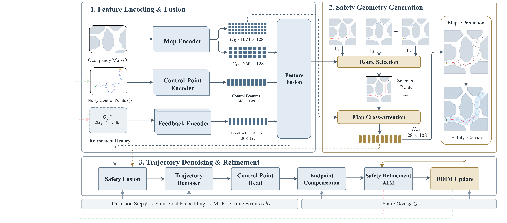
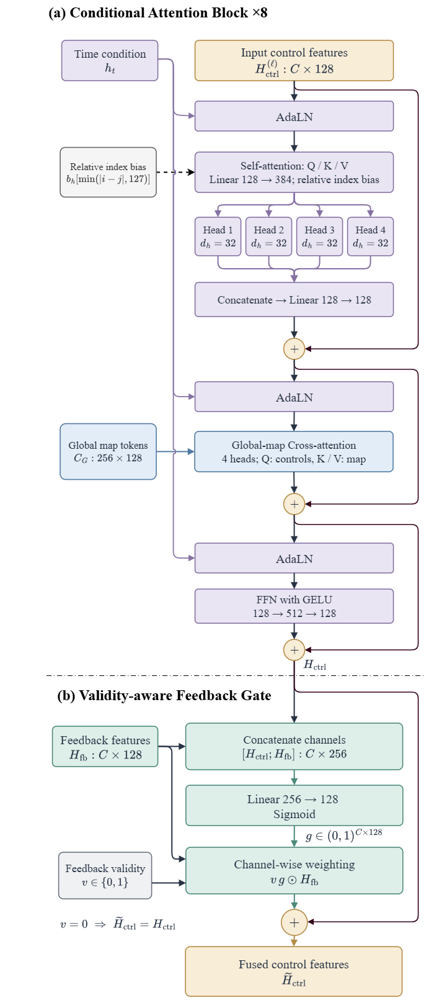
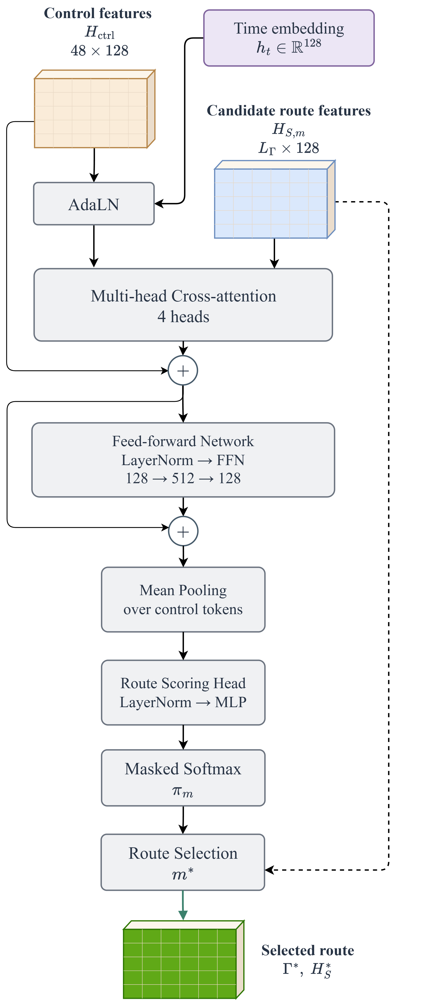
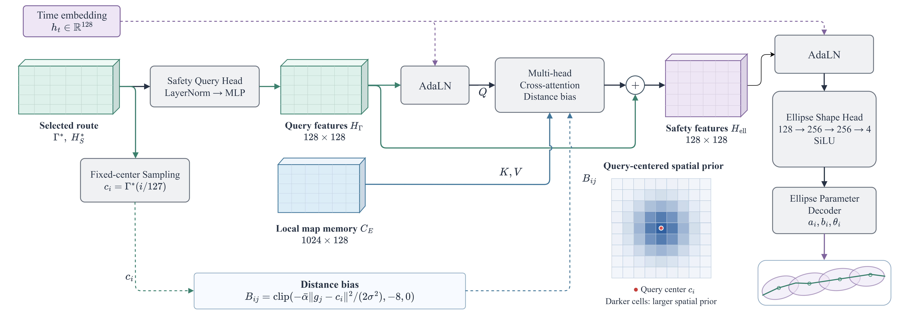
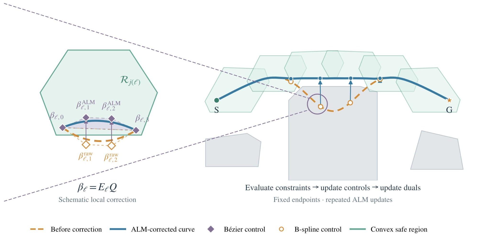

### 3.1 总体框架

给定二维占据栅格 $O\in\{0,1\}^{H\times W}$、起点 $S\in\mathbb R^2$ 和终点 $G\in\mathbb R^2$，本文采用 $C=48$ 个控制点的夹持三次 B 样条生成连续轨迹。记控制点集合为 $Q=[q_0,\ldots,q_{C-1}]\in\mathbb R^{C\times2}$，则

$$
\tau(u)=\sum_{j=0}^{C-1}B_{j,3}(u)q_j,\quad u\in[0,1].
$$

其中，$B_{j,3}$ 为三次 B 样条基函数。夹持形式满足端点插值性质，因此固定 $q_0=S$、$q_{C-1}=G$，仅在内部控制点上执行扩散生成。对参考控制点 $Q_0$ 施加高斯噪声：

$$
q_{t,j}=\sqrt{\bar\alpha_t}\,q_{0,j}+\sqrt{1-\bar\alpha_t}\,\epsilon_j,
\quad \epsilon_j\sim\mathcal N(0,I),\quad j=1,\ldots,C-2.
$$

其中，$\bar\alpha_t$ 为扩散过程的累计信号系数。推理时从内部控制点的高斯噪声开始逆扩散，首末控制点始终固定。

**图 3-1 TrajSafe-Diffuser 总体框架。**

如图 3-1 所示，方法由特征编码与融合、安全特征与约束生成、轨迹去噪与安全修正三部分组成。占据地图、带噪控制点与历史修正经编码融合后用于候选通路匹配；沿选定通路预测局部安全几何，并生成用于去噪的安全隐特征及用于约束修正的凸安全走廊。去噪预测经端点补偿和增广拉格朗日法（ALM）修正后，通过 DDIM 状态更新与历史反馈影响后续采样。

### 3.2 特征编码与融合

**（1）地图与控制点特征编码**

地图编码器提取全局地图记忆 $C_G\in\mathbb R^{256\times128}$ 和局部地图记忆 $C_E\in\mathbb R^{1024\times128}$，分别对应 $16\times16$ 和 $32\times32$ 的空间分辨率，并叠加空间位置编码。前者参与控制点编码和去噪，后者用于安全几何查询。带噪控制点 $q_{t,j}$ 经坐标编码及 MLP 映射后，与控制点索引编码相加，得到

$$
X_j^{(0)}=\operatorname{MLP}_T\bigl(\Phi_{xy}(q_{t,j})\bigr)+\operatorname{PE}_{1D}(j).
$$

其中，$\Phi_{xy}$ 和 $\operatorname{PE}_{1D}$ 分别提供空间位置与控制点顺序信息。

**图 3-2 条件注意力与历史反馈门控融合。** (a) 条件注意力模块由控制点自注意力、全局地图交叉注意力及前馈网络组成，通过时间条件调制和残差连接提取控制特征；(b) 通过反馈有效标志与逐通道门控，将历史安全修正特征融合至当前控制特征。

如图 3-2(a) 所示，控制特征经过八层条件注意力模块，每层包含控制点自注意力、以 $C_G$ 为键和值的地图交叉注意力及前馈网络，均使用残差连接。注意力头数为 4，特征维度为 128。时间步 $t$ 经正弦编码和 MLP 得到 $h_t$，并通过自适应层归一化调制各子层：

$$
\operatorname{AdaLN}(X,h_t)
=\bigl(1+\gamma(h_t)\bigr)\odot\operatorname{LN}(X)+\beta(h_t).
$$

其中，$\gamma$、$\beta$ 为时间条件生成的通道缩放和偏移参数。编码输出为 $H_{\mathrm{ctrl}}\in\mathbb R^{48\times128}$。

**（2）历史安全反馈融合**

为利用此前的轨迹修正结果，将最近一次通过接纳检查的控制点 $Q_{\mathrm{hist}}$、修正量 $\Delta Q_{\mathrm{hist}}$ 和有效标志 $v\in\{0,1\}$ 作为反馈输入。各控制点对应的五维向量经 $5\rightarrow64\rightarrow128$ 的 MLP 编码为 $H_{\mathrm{fb}}\in\mathbb R^{48\times128}$。图 3-2(b) 中的逐通道门控为

$$
\begin{aligned}
g&=\sigma\bigl(W_g[H_{\mathrm{ctrl}};H_{\mathrm{fb}}]+b_g\bigr),\\
\widetilde H_{\mathrm{ctrl}}&=H_{\mathrm{ctrl}}+v\,g\odot H_{\mathrm{fb}}.
\end{aligned}
$$

其中，$[\cdot;\cdot]$ 表示通道拼接，$\sigma$ 为 Sigmoid 函数，$g\in\mathbb R^{48\times128}$。当 $v=0$ 时，反馈分支不改变当前控制特征；有效反馈则按控制点和通道自适应注入。融合结果 $\widetilde H_{\mathrm{ctrl}}$ 供通路匹配及条件去噪使用。

### 3.3 安全特征与约束生成

**（1）通路匹配与选择**

**图 3-3(a) 候选通路匹配与选择。** 融合控制特征作为查询，候选通路特征作为键和值，经时间调制的交叉注意力及前馈残差模块形成匹配特征，再经平均池化、评分头和掩码 Softmax 选取任务相关通路。

从自由空间提取最多 $M$ 条候选通路 $\{\Gamma_m\}_{m=1}^{M}$，经等弧长重采样和编码得到 $H_{S,m}\in\mathbb R^{128\times128}$。如图 3-3(a) 所示，以 $\widetilde H_{\mathrm{ctrl}}$ 为查询、$H_{S,m}$ 为键和值执行时间条件交叉注意力，并经前馈残差模块得到匹配特征 $R_m\in\mathbb R^{48\times128}$。对控制点维度平均池化后，经评分头得到 $\ell_m$，并在有效候选集合 $\mathcal V$ 上计算

$$
\pi_m=\frac{\exp(\ell_m)}{\sum_{k\in\mathcal V}\exp(\ell_k)},\qquad m\in\mathcal V.
$$

优先选择评分最高的候选；若其安全走廊构建失败，则依次尝试其余候选。成功激活走廊后，固定选定通路 $\Gamma^*$ 及其特征 $H_S^*$，避免后续采样中的通路与约束不一致。

**（2）局部安全几何预测**

**图 3-3(b) 局部安全特征与椭圆几何预测。** 沿所选通路固定采样安全中心，并将中心与地图位置之间的距离偏置加入交叉注意力；所得安全隐特征经椭圆形状头输出局部半轴与方向，用于后续凸安全区域构造。

沿 $\Gamma^*$ 等弧长采样 $N_q=128$ 个固定安全中心 $c_i=\Gamma^*(i/(N_q-1))$。网络仅预测其对应椭圆的尺度与方向，避免直接回归中心位置可能导致的障碍侵入和凸区域构建失败。所选通路特征经安全查询网络形成 $H_\Gamma\in\mathbb R^{128\times128}$，并查询局部地图记忆 $C_E$。为优先关注中心附近的障碍结构，在每个注意力头的归一化前得分中加入空间偏置：

$$
\begin{aligned}
\mathcal B_{ij}^{\mathrm{geo}}&=\operatorname{clip}\!\left(-\frac{\bar\alpha_t\|c_i-z_j\|_2^2}{2\sigma_{\mathrm{geo}}^2},-b_{\mathrm{clip}},0\right),\\
w_{ij}&=\operatorname{softmax}_j\!\left(\frac{q_i^\top k_j}{\sqrt{d_h}}+\mathcal B_{ij}^{\mathrm{geo}}\right).
\end{aligned}
$$

其中，$z_j$ 为地图 token 的空间位置，$q_i,k_j$ 为查询和键的投影向量，$d_h$ 为单头维度；$\sigma_{\mathrm{geo}}$ 和 $b_{\mathrm{clip}}$ 分别控制距离衰减尺度和截断范围。随着逆扩散中 $\bar\alpha_t$ 增大，距离偏置强化局部查询。所得安全特征为

$$
H_{\mathrm{ell}}=H_\Gamma+\operatorname{CA}_{\mathcal B^{\mathrm{geo}}}\bigl(\operatorname{AdaLN}(H_\Gamma,h_t),C_E\bigr).
$$

椭圆形状头从 $H_{\mathrm{ell}}\in\mathbb R^{128\times128}$ 预测 $e_i=(\log a_i,\log b_i,\cos2\theta_i,\sin2\theta_i)$，并与固定中心 $c_i$ 共同确定局部椭圆。**预测椭圆仅提供几何尺度与方向先验，不直接保证无障碍。** 随后，确定性几何构造器以完整障碍栅格方格及地图边界为约束，结合安全裕度与几何分离形成凸安全区域

$$
\mathcal R_i=\{x\in\mathbb R^2\mid A_ix\leq b_i\}.
$$

其中，$A_i,b_i$ 为半空间参数。构造器检查区域与障碍的相交关系及相邻区域的重叠，必要时添加桥接区域，得到有序凸安全走廊 $\mathcal C$。因此，同一通路生成的 $H_{\mathrm{ell}}$ 与 $\mathcal C$ 分别提供学习型去噪条件和显式轨迹约束。

### 3.4 轨迹去噪与安全修正

**（1）安全条件去噪与端点补偿**

**图 3-4(a) 安全条件融合与控制点预测。** 控制特征通过交叉注意力读取局部安全隐特征，融合特征经三层条件去噪模块、坐标预测头和端点补偿得到满足起终点位置约束的控制点。

如图 3-4(a) 所示，$\widetilde H_{\mathrm{ctrl}}$ 作为查询，通过四头交叉注意力读取安全特征 $H_{\mathrm{ell}}$，并经残差融合及 MLP 形成 $F\in\mathbb R^{48\times128}$。随后通过三层具有独立参数的条件去噪模块，以全局地图记忆 $C_G$ 和时间特征 $h_t$ 为条件预测干净控制点 $\widehat Q_{0,\mathrm{raw}}^{(t)}$。单层去噪模块如图 3-4(b) 所示，其自注意力、地图交叉注意力及前馈结构与第 3.2 节的条件注意力编码形式一致，此处不再重复展开。

**图 3-4(b) 单层条件去噪模块。** 通过 AdaLN 注入扩散时间条件，依次进行控制点自注意力、全局地图交叉注意力和前馈变换，三个子层分别采用残差连接。

为满足固定起终点并缓和直接替换端点引起的局部形变，将首末预测误差按固定权重补偿至邻近控制点：

$$
\widehat q_{0,\mathrm{bdry},j}^{(t)}=\widehat q_{0,\mathrm{raw},j}^{(t)}
+w_j^S\bigl(S-\widehat q_{0,\mathrm{raw},0}^{(t)}\bigr)
+w_j^G\bigl(G-\widehat q_{0,\mathrm{raw},C-1}^{(t)}\bigr).
$$

其中，$w_j^S,w_j^G$ 为起终点邻域的固定权重，满足 $w_0^S=w_{C-1}^G=1$、$w_0^G=w_{C-1}^S=0$，从而保证补偿后两端点分别为 $S,G$。记所得控制点为 $\widehat Q_{0,\mathrm{bdry}}^{(t)}$。

**（2）连续轨迹安全约束与 ALM 修正**

为约束整条连续曲线，将 B 样条节点区间与安全区域责任区间共同细分，并将每个子区间转换为三次 Bézier 形式。第 $\ell$ 段的四个控制点满足

$$
\beta_\ell=E_\ell Q,\qquad E_\ell\in\mathbb R^{4\times48}.
$$

根据 Bézier 凸包性质，只要各段四个控制点位于所分配的凸区域 $\mathcal R_{j(\ell)}$，对应整段曲线便位于该区域内。因此连续安全条件可由原 B 样条控制点上的线性不等式充分保证：

$$
g_{\ell,r,f}(Q)=a_{j(\ell),f}^{\mathsf T}(E_\ell Q)_r-b_{j(\ell),f}\leq0,
\quad r=0,1,2,3.
$$

其中，$f$ 为凸区域半空间编号；汇总约束记为 $g(Q)\leq0$，不引入额外的独立 Bézier 优化变量。

**图 3-5 连续曲线安全约束与 ALM 修正示意。** 右侧展示固定起终点条件下，预测轨迹及 B 样条控制点经过 ALM 修正后的变化；左侧放大局部 Bézier 曲线及其控制点，说明控制点约束与凸区域归属之间的关系。

以 $Q^{\mathrm{ref}}=\widehat Q_{0,\mathrm{bdry}}^{(t)}$ 为参考，采用 ALM 求解

$$
\begin{aligned}
\min_Q\quad J(Q-Q^{\mathrm{ref}})={}&\frac{\lambda_p}{2}\|B(Q-Q^{\mathrm{ref}})\|_F^2
+\frac{\lambda_s}{2}\|D_2B(Q-Q^{\mathrm{ref}})\|_F^2,\\
\mathrm{s.t.}\quad &g(Q)\leq0,\quad q_0=S,\quad q_{C-1}=G.
\end{aligned}
$$

其中，$B$ 为 B 样条采样基矩阵，$D_2$ 为二阶差分算子；两项分别抑制修正后的轨迹偏移与形状变化。引入非负乘子 $\mu$ 和罚系数 $\rho$，增广拉格朗日函数为

$$
\mathcal L_\rho(Q,\mu)=J(Q-Q^{\mathrm{ref}})
+\frac{\|[\mu+\rho g(Q)]_+\|_2^2-\|\mu\|_2^2}{2\rho}.
$$

其中，$[\cdot]_+$ 表示逐元素取正部。优化中交替更新内部控制点与乘子，并保持端点固定。有限次迭代得到 $Q_{0,\mathrm{ALM}}^{(t)}$ 后执行约束残差检查；Bézier 凸包条件是连续包含关系的充分条件，但有限迭代的优化输出仍需通过实际残差确认是否满足该条件。

**（3）安全状态更新与历史反馈**

安全修正经两条路径影响后续逆扩散。首先，用 $Q_{0,\mathrm{ALM}}^{(t)}$ 重新计算噪声并进行确定性 DDIM 更新：

$$
\begin{aligned}
\widehat\epsilon_t&=\frac{Q_t-\sqrt{\bar\alpha_t}\,Q_{0,\mathrm{ALM}}^{(t)}}{\sqrt{1-\bar\alpha_t}},\\
Q_s&=\sqrt{\bar\alpha_s}\,Q_{0,\mathrm{ALM}}^{(t)}+\sqrt{1-\bar\alpha_s}\,\widehat\epsilon_t,\qquad s<t.
\end{aligned}
$$

更新后仍固定首末控制点。其次，对通过接纳检查的结果缓存 $Q_{\mathrm{hist}}=Q_{0,\mathrm{ALM}}^{(t)}$ 及 $\Delta Q_{\mathrm{hist}}=Q_{0,\mathrm{ALM}}^{(t)}-\widehat Q_{0,\mathrm{bdry}}^{(t)}$，并按第 3.2 节的门控方式参与下一步特征融合。若修正未通过接纳检查，则不覆盖已有有效历史。DDIM 路径直接改变后续采样状态，历史反馈路径则为下一次网络预测提供此前的修正信息。

### 3.5 训练策略与损失函数

**（1）共享参数的两次前向训练**

为使网络能够利用逆扩散过程中的历史安全修正信息，本文采用共享参数的两次前向训练策略。首先，随机采样扩散时间步 $t$，对参考控制点加噪得到 $Q_t$，在无历史反馈条件下执行第一次网络前向，预测干净控制点。随后，利用参考通路对应的离线凸安全走廊执行 ALM 修正，并根据约束残差检查构造历史修正控制点、修正量及有效标志。当原始预测已满足约束时，反馈修正量置零；当修正结果未通过检查时，反馈标志置为无效。利用修正后的控制点执行一次 DDIM 更新，得到相邻时间步 $s=t-1$ 的状态 $Q_s$。

第二次前向接收 $Q_s$ 和构造的历史反馈，使用相同网络参数再次预测干净控制点。ALM 求解、约束检查、反馈构造及 DDIM 状态更新均停止梯度传播，使第二次预测的梯度不经过上述过程反传至第一次预测。训练中以 25% 的概率随机屏蔽历史反馈，以适应推理初期尚无有效反馈的情况。

**（2）损失函数**

为同时优化轨迹预测精度、安全几何表示及轨迹约束满足程度，本文采用轨迹预测、安全几何和安全约束三类损失。

**轨迹预测损失：** 包括控制点重建损失 $\mathcal L_{\mathrm{ctrl}}$、边界损失 $\mathcal L_{\mathrm{boundary}}$ 和控制点平滑损失 $\mathcal L_{\mathrm{smooth}}$。其中，控制点重建损失计算预测的内部控制点与参考控制点之间的均方误差。边界损失用于约束起终点附近的控制点形状。具体而言，分别将参考控制点集合平移，使其起点或终点与当前规划任务对齐，得到两组局部参考控制点；再对预测控制点与对应参考控制点计算加权平方误差，权重随控制点远离起终点而减小。该损失主要限制端点附近的轨迹形状变化，而起终点位置约束由端点补偿机制直接满足。控制点平滑损失利用预测控制点的二阶和三阶差分衡量局部形状变化，并通过参考控制点的平均间距进行归一化，以减小不同轨迹尺度的影响。

**安全几何损失：** 包括通路分类损失 $\mathcal L_{\mathrm{topo}}$、椭圆形状损失 $\mathcal L_{\mathrm{shape}}$、区域重叠损失 $\mathcal L_{\mathrm{IoU}}$ 和椭圆安全损失 $\mathcal L_{\mathrm{safe}}$。其中，通路分类损失采用交叉熵监督候选通路选择，其监督标签由参考轨迹与候选通路之间的归一化动态时间规整距离确定。椭圆形状损失采用均方误差约束预测的对数半轴及双角方向参数；区域重叠损失通过预测椭圆与参考椭圆软栅格掩码的交并比衡量空间覆盖差异。椭圆安全损失则根据预测椭圆与障碍区域的重叠比例计算，结合平均侵入比例与最严重 20% 区域的平均侵入程度，降低局部安全几何的障碍占据风险。

**安全约束损失：** 包括走廊损失 $\mathcal L_{\mathrm{alm}}$ 和连续安全损失 $\mathcal L_{\mathrm{fb,safe}}$。其中，走廊损失作用于第一次预测解码得到的轨迹采样点，计算采样点相对于有效凸安全走廊的约束违规程度，并对超过容差的违规施加惩罚。连续安全损失作用于第二次前向的预测结果，利用第 3.4 节定义的 Bézier 控制点不等式，计算全部约束中的最大正残差。与基于离散轨迹采样点的走廊损失不同，连续安全损失直接约束 Bézier 控制点，以降低第二次预测的连续曲线约束违规。此外，第二次前向还采用曲线平滑损失 $\mathcal L_{\mathrm{curve}}$，对解码后的 B 样条曲线施加二阶和三阶差分惩罚。

